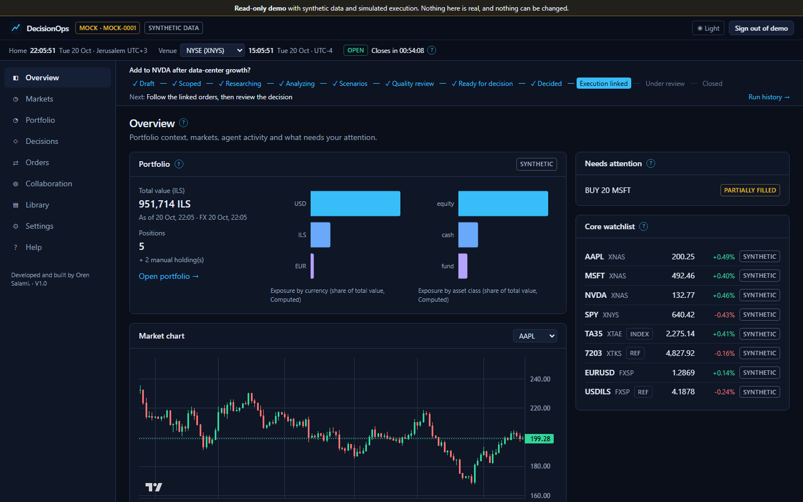
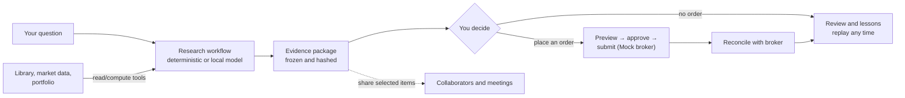
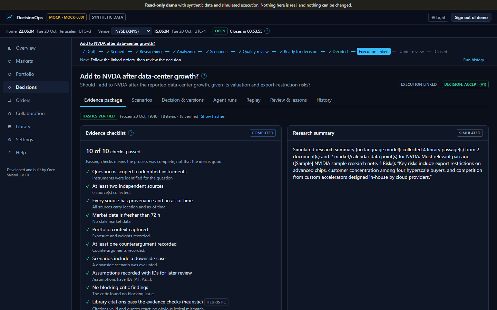
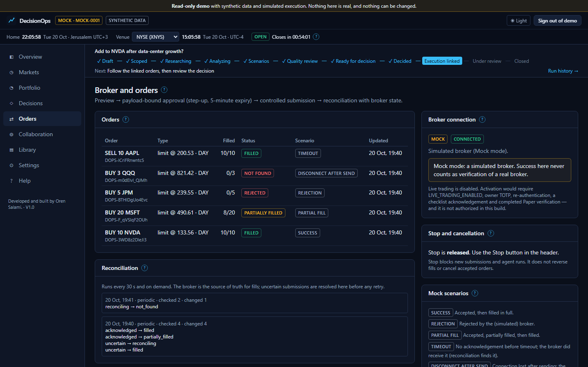
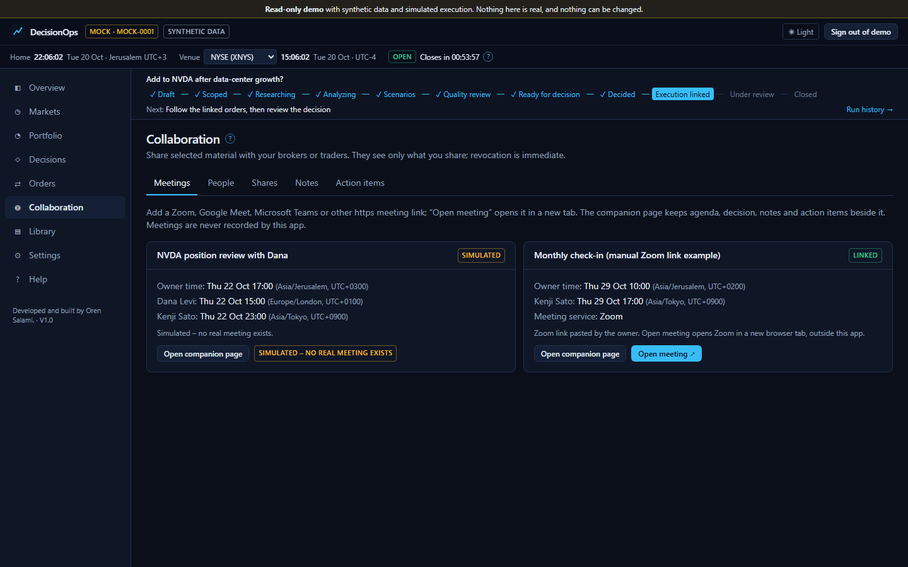

# Investment DecisionOps AI

A private, local workspace for making investment decisions you can explain later. It helps you research a
question, freezes the evidence you decided on, routes any order through approval and keeps a record you can replay
and review.



## What it does

- **Research a question.** A workflow gathers library passages, market data and portfolio context, then writes
  scenarios, counterarguments and a summary. It runs deterministically or, if you choose, with a local model
  (Ollama, `qwen3:4b`). Agents use read/compute tools only, so they can analyse and propose but never approve or
  trade.
- **Freeze the evidence.** When you decide, the evidence package is frozen with a hash for each item. You can replay
  any decision exactly as it was made, add corrections as new versions and write reviews with lessons.
- **Keep a knowledge library.** Upload PDF, Markdown, text or CSV files, ask questions and get answers that cite the
  exact passage. Remove a document from retrieval, or erase it everywhere.
- **Watch markets and your portfolio.** Venue clocks and trading calendars (New York, London, Tel Aviv, Tokyo and FX),
  manual holdings and exposure charts. Market data is synthetic in this build.
- **Place orders safely.** Preview, then approve with re-authentication, then submit once, then reconcile with the
  broker. A **Stop** button blocks new submissions and agent runs. The broker is a built-in **Mock**; live trading
  is disabled.
- **Work with your brokers or traders.** Invite people, share only what you choose, comment, track action items
  and run meetings through Zoom, Google Meet, Microsoft Teams or other links.

Every result is labelled *Simulated*, *Computed* or *Model-generated*, so you always know what produced it.

## Why it's useful

Most tools show you a signal. This one leaves you a **decision record**: what you knew, what you assumed, what you
decided and how it turned out. That makes your own process reviewable. It is local-first (bound to
`127.0.0.1`, works offline after setup), keeps your data on your machine and is honest about what its checks prove.
A Mock success is never presented as a real broker result.

## How it works



The app is one Python codebase (FastAPI API, worker and read-only demo API) with a React front end, PostgreSQL and
Caddy, all in Docker Compose. Details: [architecture overview](docs/architecture/overview.md).

## How to run it

You need Docker Desktop (Compose v2). Optional: [Ollama](https://ollama.com) on the host with `qwen3:4b` for
model-enabled research.

```sh
cp .env.example .env          # set the database passwords; optionally OWNER_EMAIL and OWNER_PASSWORD
docker compose up --build -d
```

Open **<http://127.0.0.1:8087>**. The port is bound to `127.0.0.1`, so only this computer can reach it (change it
with `APP_PORT`).

- **Your account:** if `OWNER_EMAIL` and `OWNER_PASSWORD` are set, the owner account is created on the first
  start. Otherwise the setup screen asks for a one-time token:
  `docker compose exec api python -m app.cli setup-token`.
- **Stop:** `docker compose down` keeps your data. `docker compose down -v` **deletes** it.
- **Secrets:** `.env` holds real secrets. It is excluded from Git and from Docker images.

More options, offline use and recovery: [setup guide](docs/guides/setup.md). Backups:
[operations](docs/guides/operations.md).

### Try the demo

Open <http://127.0.0.1:8087/demo/> and sign in with `demo@example.com` / `demo-read-only`. These demo credentials
are public on purpose. The demo is a separate instance with its own synthetic database and a read-only account:
nothing can be changed, and it cannot see your workspace.

| | |
| --- | --- |
|  |  |

### Add a meeting link

1. Go to **Collaboration → Meetings → Schedule meeting** (or **Edit meeting** on an existing card).
2. Choose **Meeting link**, then pick the provider: **Zoom**, **Google Meet**, **Microsoft Teams** or **Other**.
3. Paste the `https://` link from the meeting service and save.
4. Click **Open meeting ↗** to join in a new browser tab. Keep the companion page open beside the call for the
   agenda, shared decision, notes and action items.

The app checks links before saving: https only, the host must match the provider (for example `meet.google.com`
for Google Meet), and no embedded passwords, IP addresses or local names. Nothing is embedded or recorded. Zoom
meetings can optionally be created through the Zoom API if you configure a Zoom app. Full guide:
[Meetings help](help/zoom-meetings.md).



## What is verified

| Capability | Status |
| --- | --- |
| Mock broker, synthetic market data, research workflow, library, calendars, collaboration, demo | Verified locally, works offline after setup |
| Meeting links (Zoom, Google Meet, Microsoft Teams, other https) | Verified locally (links are checked, saved and opened; no provider API is called) |
| Local model (Ollama `qwen3:4b`) | Verified locally (a full model cycle takes about 7 minutes on a CPU) |
| Interactive Brokers Paper, Zoom scheduling API | Built, not verified against the real services (not configured) |
| Live trading | Not available: not authorized |
| Cloud deployment (Terraform, AWS Lightsail) | Static checks only, nothing deployed |

For personal use only, with no compliance claims. Evidence checks are heuristics. See
[known limitations](docs/known-limitations.md).

## Documentation

The [documentation index](docs/README.md) covers everything. Common entry points:

- [Setup](docs/guides/setup.md) · [Operations and backups](docs/guides/operations.md) · [Deployment](docs/guides/deployment.md)
- [Architecture](docs/architecture/overview.md) · [Agents and MCP](docs/architecture/agents-and-mcp.md) ·
  [Knowledge library](docs/architecture/rag.md) · [Broker integration](docs/architecture/broker-integration.md)
- [Security](docs/security/threat-model.md) · [Governance](docs/security/governance.md) · [Testing](docs/testing/README.md)
- In-app Help Center at `/help` (sources in [`help/`](help/))

Development checks (lint, types, tests, API contract, security scans): `scripts/check.sh` or
`pwsh scripts/check.ps1`.

---

Developed and built by Oren Salami. · V1.0
