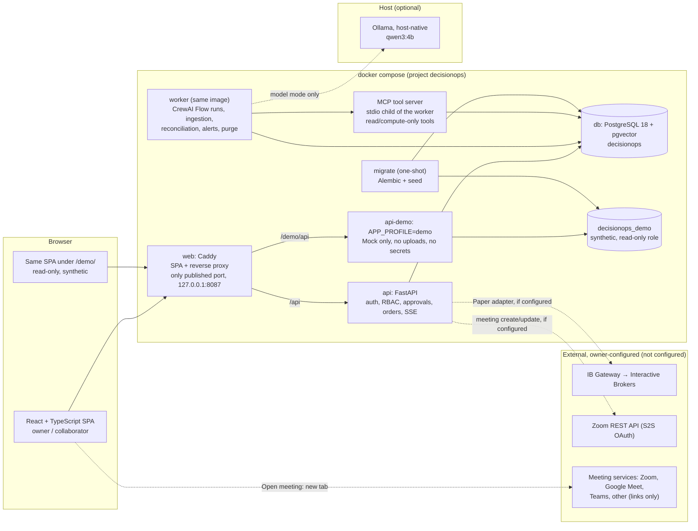

# Architecture

A modular monolith: one Python codebase runs as the API, the worker and the read-only demo API, behind one
Caddy port. PostgreSQL (with pgvector) holds everything: relational data, full-text search, optional vectors,
jobs, sessions and audit. No Redis, queue, vector database or Kubernetes.

Solid lines work offline after setup. Dashed lines are optional and, in this build, either not configured
(IBKR, Zoom API) or depend on the owner running Ollama. See [setup.md](../guides/setup.md#offline-operation).

## Components

| Component | Responsibility | Notes |
| --- | --- | --- |
| `web` | Serves the built SPA, proxies `/api` → `api` and `/demo/api` → `api-demo`, sets CSP and security headers | Only service with a published port (`127.0.0.1:${APP_PORT}`) |
| `api` | REST + SSE, sessions, CSRF, permissions, approvals, order controls | Every route declares a permission; a route-inventory test fails otherwise |
| `worker` | Job table (`FOR UPDATE SKIP LOCKED`, leases, heartbeats), workflow runs, ingestion, reconciliation every 30 s, alerts every minute, retention purge every 6 h | Drains its current job on SIGTERM |
| MCP server | Read/compute tools for agents over stdio (no network listener) | See [agents-and-mcp.md](agents-and-mcp.md) |
| `api-demo` | Same code with `APP_PROFILE=demo` against `decisionops_demo` | DB role has no grants on the owner DB; unsafe methods refused |
| `migrate` | Alembic migrations for both databases, synthetic seed, optional owner bootstrap from `.env` | Exits; `api` waits for it |
| `db` | One PostgreSQL server, two databases, separate roles | `pg_isready` healthcheck |

## Backend modules

`backend/app/modules/`: `identity` · `audit` · `markets` · `calendar` · `portfolio` · `decisions` · `workflows` ·
`agents` · `mcp_tools` · `knowledge` · `brokers` · `orders` · `collaboration` · `meetings` · `help` · `ops` ·
`settings`. Each owns its models, services and router. One injected clock makes time-dependent behaviour testable.

## Frontend

Vite + React 19 + TypeScript (strict). A small in-repo UI kit on Radix primitives with Tailwind CSS v4, TanStack
Query for server state (invalidated by SSE events), Zustand for UI preferences, React Hook Form with an in-repo Zod
resolver. Request bodies are typed from the generated OpenAPI schema (`frontend/src/api/contract.ts`); response
types are hand-written (`src/api/types.ts`) because the backend returns plain dicts. Charts: TradingView Lightweight
Charts (attribution shown) and Recharts.

## Key flows

- **Decision:** question → workflow run (scope → research → analysis → scenarios → critic) → frozen evidence
  package (per-item SHA-256) → owner decision with rationale → optional order → review and lessons. Replays read
  the frozen snapshot, so later data never changes what a past decision shows.
- **Order:** ticket → preview (costs or "Unknown") → step-up approval bound to the payload hash (5 min) → submit
  with a unique client order ID → reconciliation is the source of truth for fills. Details:
  [broker-integration.md](broker-integration.md).
- **Meeting:** the owner saves a validated https link (Zoom, Google Meet, Microsoft Teams or other) or, optionally,
  creates a Zoom meeting through the Zoom API. **Open meeting** opens the link in a new tab (`noopener noreferrer`);
  the app never embeds or records the call (decision D-A).
- **Erasure:** content removed from DB, files and index; frozen evidence items redacted with a visible event; an
  erasure-ledger entry is written to the DB and to a file outside the dump so a restore re-applies it. Details:
  [operations.md](../guides/operations.md#erasure-ledger).
