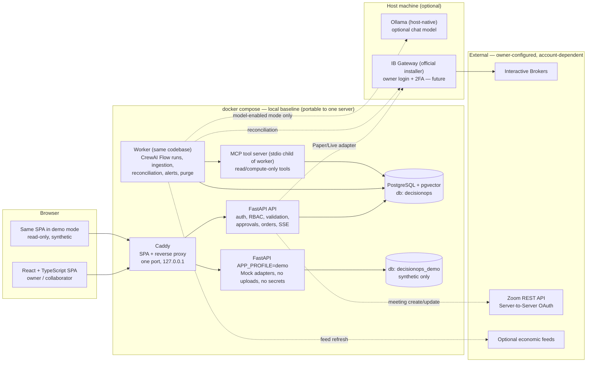
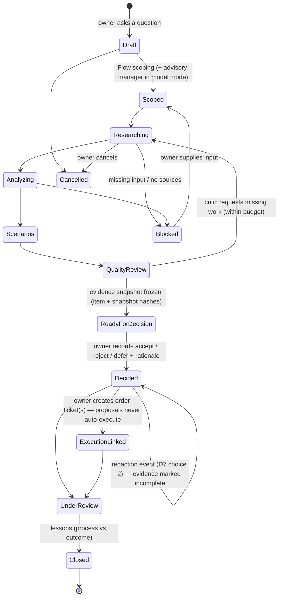

# Investment DecisionOps AI — Implementation Plan

**Status:** **Approved execution plan** (revision 3). On 19 Oct 2026 the owner instructed: build the complete application from this plan using its recommended defaults for the remaining decisions, complete testing, Docker verification and documentation, keep Live trading disabled, and do not deploy or incur costs. This file was therefore renamed from `IMPLEMENTATION_PLAN.md` to `PROJECT_PLAN.md` (D8) and is the single authoritative plan. Defaults adopted for §27: D-A external join + companion page; D-B AWS Lightsail (Terraform prepared, never applied); D-C local model download allowed (free). Deviations made during implementation are recorded in `DECISIONS.md`, not here.

*Location note (20 Oct 2026): this plan, `TASKS.md` and `DECISIONS.md` now live in `docs/project/`; the original brief and `HANDOFF.md` are kept local-only (owner decision in `DECISIONS.md`, superseding D8's "brief at the root"). The brief's content is unchanged.* *The text below is revision 3 as approved. Statements such as "nothing is implemented yet" describe the state at approval time; current delivery status lives in `TASKS.md` and `HANDOFF.md`.*

**Prepared for:** Oren Salami (owner).

**Source of requirements:** `Investment_DecisionOps_AI_Project_Brief.md` (18 October 2026), at the repository root. It is preserved unmodified and is byte-identical to the owner's original copy. Requirement changes are recorded as decisions, never by editing the brief.

**Previous investment project:** not inspected, not reused.

**Revision history**

| Rev | Date | Summary |
| --- | --- | --- |
| 1 | 18 Oct 2026 | Initial plan |
| 2 | 18 Oct 2026 | Brief location updated after it was added to the repo root |
| 3 | 18 Oct 2026 | Owner resolved D1–D8 (§4). Corrections applied: manager/agent-team dual mode, honest RAG evidence checks and evaluation, delivery-status model, offline first-run vs. after-setup, lean-scope review. Local hardware inspected. Deployment target comparison added from official pricing. Document deletion redesigned as two explicit choices |

**Conventions**

- **Requirement:** agreed scope from the brief.
- **Owner decision:** a resolution recorded in §4.
- **Recommendation:** Claude's proposal; needs approval.
- **Assumption:** a routine engineering choice Claude made; labelled.
- **Unverified:** not yet confirmed from an official source. Collected in §29 with its impact.
- Nothing in this plan is implemented or tested yet. Every item's delivery status today is **Not implemented** (§5).

---

## Contents

1. [Product understanding](#1-product-understanding)
2. [Requirements coverage matrix](#2-requirements-coverage-matrix)
3. [Recommended stack and architecture](#3-recommended-stack-and-architecture)
4. [Owner decisions recorded in revision 3](#4-owner-decisions-recorded-in-revision-3)
5. [Delivery status model](#5-delivery-status-model)
6. [Screens, navigation and user journeys](#6-screens-navigation-and-user-journeys)
7. [Global clocks, trading calendars and time](#7-global-clocks-trading-calendars-and-time)
8. [Decision records, evidence and learning](#8-decision-records-evidence-and-learning)
9. [Agent team, manager and MCP boundaries](#9-agent-team-manager-and-mcp-boundaries)
10. [Local RAG, evidence checks and document deletion](#10-local-rag-evidence-checks-and-document-deletion)
11. [Optional local LLM and this machine's hardware](#11-optional-local-llm-and-this-machines-hardware)
12. [Broker integration, portfolio and controlled execution](#12-broker-integration-portfolio-and-controlled-execution)
13. [Collaboration and Zoom](#13-collaboration-and-zoom)
14. [Identity, roles, local demo and personal data](#14-identity-roles-local-demo-and-personal-data)
15. [Data entities and lifecycles](#15-data-entities-and-lifecycles)
16. [Security, observability, governance and regulatory mapping](#16-security-observability-governance-and-regulatory-mapping)
17. [Testing strategy](#17-testing-strategy)
18. [Docker local startup and offline operation](#18-docker-local-startup-and-offline-operation)
19. [Deployment target and Terraform preparation](#19-deployment-target-and-terraform-preparation)
20. [Documentation, Help Center and screenshots](#20-documentation-help-center-and-screenshots)
21. [Persistent development state and planning files](#21-persistent-development-state-and-planning-files)
22. [Repository structure](#22-repository-structure)
23. [External dependency matrix](#23-external-dependency-matrix)
24. [Recommendations: corrections, enhancements, overhead to avoid](#24-recommendations-corrections-enhancements-overhead-to-avoid)
25. [Milestones](#25-milestones)
26. [Assumptions](#26-assumptions)
27. [Remaining owner decisions](#27-remaining-owner-decisions)
28. [Readiness assessment](#28-readiness-assessment)
29. [Unverified external facts and their impact](#29-unverified-external-facts-and-their-impact)
30. [Sources](#30-sources)

---

## 1. Product understanding

Investment DecisionOps AI is a **personal investment workspace** whose main output is a **traceable decision record**, not a trade signal.

A question goes through a fixed workflow: scoping, research, portfolio and market analysis, scenarios, then critical quality review. The result is a frozen **evidence package**: sources, data timestamps, assumptions, counterarguments, scenario results, checks and open issues. The owner decides and records a rationale. If an order follows, it is:

1. prepared;
2. approved against its exact payload;
3. submitted through a controlled broker path;
4. reconciled with broker state.

Later, the decision is reviewed against what happened, and **process quality is assessed separately from P&L**.

Distinctive value:

1. **Replayable evidence.** Historical decisions show what was known at the time. When content is ever erased, the record says so visibly.
2. **Engineering discipline as a product feature.** Deterministic checks, explicit workflow state, payload-bound approvals, reconciliation, audit and observability, presented in plain language.
3. **AI under control.** A manager-led CrewAI team and MCP tools do analysis work. They may **propose** actions but cannot authorize, approve or execute anything.
4. **Honest modes and labels.** Mock, Paper and Live are visibly separated. Every output is labelled **Simulated**, **Computed** or **Model-generated**. Mock success is never presented as real-provider verification.
5. **Globally aware.** Exchange-correct clocks and calendars, and dual-timezone collaboration with brokers abroad.

**Users:**

- the owner, managing their own money;
- invited brokers or traders, who see only explicitly shared material;
- visitors to a local, isolated, read-only demo.

**Out of scope:** managing other people's accounts, and any public brokerage or advisory business.

---

## 2. Requirements coverage matrix

| Brief § | Requirement area | Plan section | Milestone(s) | Acceptance evidence | Highest status reachable without external accounts |
| --- | --- | --- | --- | --- | --- |
| 1 | Planning only; decisive recommendations; approval before build | This document; §4, §27 | — | Owner approval recorded in `DECISIONS.md` | n/a |
| 2 | Traceable decisions; QA/DevOps/AI character without enterprise overhead | §1, §8, §16 | M4, all | Replay test, audit trail, plain-language review | Verified locally |
| 3 | Equities, FX, indices; reference vs. tradable; 3 broker capability levels; supported-market matrix; one real broker behind an adapter; offline demo | §7.2, §12 | M2, M7, M8 | Market matrix; adapter contract tests; offline demo | Locally verified (Mock); IBKR **externally unverified** |
| 4 | React + TS; component system; charts; state; restrained modern UI; responsive; a11y; themes; dashboard; persistent workflow view; navigation | §3, §6 | M1, M3, M4 | Playwright + axe; keyboard walkthrough; screenshots | Verified locally |
| 5 | Clocks, IANA zones, UTC storage, DST, holidays, early closes, breaks, overnight sessions; countdowns; research timer; source-labelled calendar; stale feeds; dual-timezone meetings | §7 | M2, M8 | Controlled-time suite (§17.3) | Verified locally (calendar library); external feeds unverified |
| 6 | Decision record fields; replay; versioned corrections; post-review; process vs. outcome; no unsupported confidence % | §8, §15 | M4 | Snapshot immutability and redaction tests | Verified locally |
| 7 | CrewAI team + manager; MCP; contracts, budgets, retries; cancel and restart; no bypass; untrusted content; no-model baseline; labelled outputs | §9 | M4, M6 | Mock cycle E2E; model cycle with timeout and cancel; injection tests | Deterministic path verified locally; model path **verified locally only once a model is run on this machine** |
| 8 | Local library; allowlist; limits; local embeddings; pgvector; citations; deletion; re-index; access scope; unsupported-answer detection; optional local LLM; mock fixtures | §10, §11 | M5, M6 | RAG evaluation set (§10.4); deletion-mode tests (§10.5) | Verified locally |
| 9 | Mock/Paper/Live separation; broker choice; preview fields; payload-bound approval with expiry; idempotency; limits; stale checks; reconciliation; uncertain outcomes; stop; cancellation; mock failure scenarios | §12, §15.3 | M7 | Mock scenario matrix; IBKR Paper contract tests when configured | Mock verified locally; Paper **externally unverified** until owner configuration |
| 10 | Collaboration space; invites; revocation; object-level access; Zoom links/scheduling; embedded SDK where justified; simulated meetings; no default recording | §13 | M8 | API access matrix; provider-unavailable tests; real Zoom check when configured | Mock/manual verified locally; Zoom API **externally unverified**; embedded video **unresolved (D-A)** |
| 11 | Sign-in/out; expiry; password storage; roles; isolated demo; recovery; optional MFA; secret hygiene; retention; export; deletion; backup and restore | §14, §10.5, §18.5 | M1, M5, M9, M10 | Direct API permission tests; secret scan; backup/restore test; erasure test | Verified locally |
| 12 | Threat model; scoped tools; validation; safe uploads; dependency checks; audit; logs/traces/health/latency/freshness/agent usage; governance; regulatory mapping | §16 | M0 onward | Threat model; ops dashboard; governance and regulatory docs | Verified locally; legal questions need qualified review |
| 13 | Modular app; FastAPI; PostgreSQL + pgvector; worker only where needed; no k8s; `docker compose up --build`; profiles; port; shutdown/backup; Terraform for one target | §3, §18, §19 | M1, M10 | Clean-start test; restart persistence; `terraform validate` | Verified locally; deployment **not performed** (not authorized) |
| 14 | Short README; real screenshots; diagram; `docs/`; Help Center | §20 | M9, M10 | Docs-vs-behaviour review; link checker; screenshots from the running app | Verified locally |
| 15 | Persistent state files; runtime state in DB; no skill now | §21 | M0 | Files exist and are updated each session | Verified locally |
| 16 | Evidence for all journeys and failure paths; focused tests; exact commands; mocks never reported as real | §5, §17, §25 | Each milestone; M10 | `docs/testing/` evidence log using the §5 statuses | — |
| 17 | Planning response items 1–14 | §1–§29 | — | This document | — |
| 18 | Suggested sequence | §25 (adjusted, reasons in §24.5) | — | — | — |
| 19 | Owner directions | §24.1 (nothing removed) | — | — | — |

---

## 3. Recommended stack and architecture

### 3.1 Architecture diagram



- Both databases run on **one PostgreSQL server**, with separate DB roles. The demo role has no grants on the owner database.
- Dashed lines are optional or owner-configured integrations. **Everything solid works offline after setup** (§18.3).

### 3.2 Stack (one recommendation per layer)

| Layer | Choice | Why | Rejected |
| --- | --- | --- | --- |
| Frontend | **Vite + React + TypeScript (strict)**, SPA | No SSR/SEO need; simplest build | Next.js |
| Components | **Tailwind CSS v4 + shadcn/ui** (Radix primitives copied into the repo) | Accessible primitives; themeable via CSS variables (dark/light); restrained custom look | MUI/AntD |
| Server state | **TanStack Query** (+ SSE-driven invalidation) | Caching, retries, stale indicators | Redux |
| Client state | **Zustand** (UI preferences only) | Tiny | Context sprawl |
| Routing | **React Router** (library mode) | Mature, simple | — |
| Forms and contracts | **React Hook Form + Zod**; TS types generated from FastAPI OpenAPI (`openapi-typescript`) | One contract source | Hand-written types |
| Financial charts | **TradingView Lightweight Charts** (Apache-2.0; **attribution and link to tradingview.com required**) | Purpose-built time series | Highcharts (commercial) |
| Other charts | **Recharts** | Simple SVG charts | ECharts |
| Workflow view | Custom stepper and timeline components from API state | Shows real state | React Flow |
| Backend | **Python 3.12, FastAPI, Pydantic v2, SQLAlchemy 2, Alembic, uv** | CrewAI needs Python ≥3.10 and <3.14; the MCP SDK needs ≥3.11 | Django |
| Database | **PostgreSQL 18 + pgvector 0.8.7** (`pgvector/pgvector:0.8.7-pg18`) | One DB for relational data, FTS, vectors, jobs, sessions, audit | Separate vector DB, Redis |
| Background work | Worker from the same codebase; Postgres job table (`FOR UPDATE SKIP LOCKED`, leases, heartbeats) + `LISTEN/NOTIFY` | Only for long runs, ingestion, reconciliation, alerts | Celery/Redis, Kafka, Temporal |
| Live updates | **Server-Sent Events** | One-way updates suffice | WebSockets |
| Agents | **CrewAI** (pinned at implementation; 1.15.28 was latest on 14 Oct 2026). **Flows** for orchestration, **Agents** for the model-enabled team | §9 | LangGraph/LangChain alongside |
| Tools | **MCP Python SDK** (spec 2026-07-28), stdio transport | Brief requirement; no network exposure | — |
| Embeddings | **fastembed** (ONNX, CPU), `BAAI/bge-small-en-v1.5`, 384-dim; optional | Local, no GPU, independent of the chat model | Ollama embeddings as default |
| Chat model (optional) | **Ollama, host-native** (already installed on this machine), default **`qwen3:4b`** | §11 | vLLM, llama.cpp server |
| Broker | **IBKR via TWS API + IB Gateway**, client `ib_async`; proposed, subject to verification | §12 | Alpaca (US-only) |
| Calendars | **exchange_calendars** 4.13.x (Apache-2.0) + in-house FX 24×5 calendar | Holidays, early closes, lunch breaks, dated schedule changes | Hard-coded hours |
| Auth | In-app sessions: Argon2id, Postgres-backed sessions, HttpOnly cookies, CSRF, optional TOTP | Proportionate to one owner | Keycloak/Auth0 |
| Proxy/TLS | **Caddy** | One config locally and on a server | Nginx + certbot |
| Observability | structlog JSON, correlation IDs, DB-derived ops dashboard, optional `/metrics` | §16.2 | Full Grafana stack by default |
| Tests | pytest (+ time-machine, hypothesis), Vitest + Testing Library, Playwright + axe-core | — | — |
| Supply chain | pip-audit, npm audit, gitleaks, ruff security rules, Trivy | — | — |
| IaC | **Terraform**; recommended target **AWS Lightsail** (Hetzner kept as a documented candidate) | §19 | Multi-cloud |

### 3.3 Backend modules (modular monolith)

`identity` · `audit` · `markets` · `calendar` · `portfolio` · `decisions` · `workflows` · `agents` · `mcp_tools` · `knowledge` · `brokers` · `orders` · `collaboration` · `meetings` · `help` · `ops` · `settings`.

- Each module owns its models, services, router and tests.
- Cross-module access goes through service interfaces.
- One injected `Clock` makes all time-dependent behaviour testable.

---

## 4. Owner decisions recorded in revision 3

These are carried into `DECISIONS.md` in M0.

| ID | Owner decision (18 Oct 2026) | Plan consequence |
| --- | --- | --- |
| **D1 Broker** | IBKR stays the **proposed** first real adapter, subject to verification of eligibility and API requirements. Opening/funding an account and installing IB Gateway are **not** prerequisites for planning or Mock implementation. No account creation, funding or subscriptions are authorized or assumed | Mock and adapter work proceed. IBKR Paper/Live remain **Implemented but externally unverified** until the owner configures an account in future (§5, §12.1) |
| **D2 TASE** | Initial TASE scope: reference information, exchange calendars, manual holdings. Real TASE execution is outside the first broker's verified capabilities. Keep the adapter interface usable by a future eligible Israeli broker; no second broker in current scope | Supported-market matrix (§7.2); venue-agnostic adapter contract (§12.2); no second adapter planned |
| **D3 Zoom** | Committed: links, scheduling, manual links, dual-timezone display. **Embedded video stays an explicit unresolved product decision** and must not block other work | §13.2–13.4; remaining decision **D-A** (§27) |
| **D4 Terraform** | Hetzner is a candidate, not approved. Compare with a small AWS or Azure deployment using official sources; recommend one. No provisioning, spending or multi-cloud implementation. Keep the app portable via Compose | §19 comparison; recommendation **AWS Lightsail**; final target confirmation is **D-B** (§27) |
| **D5 Model hardware** | Inspect this machine read-only; recommend a model from actual hardware; no installs or downloads | §11.2: 31.3 GB RAM, Intel Arc 140V (shared memory), no NVIDIA GPU. Recommendation: `qwen3:4b` default, `qwen3:8b` optional |
| **D6 Demo** | Local-only for now; synthetic data; strict isolation. Internet hosting is a separate future deployment decision | §14.3; no public demo in scope |
| **D7 Deletion** | Two explicit choices: (1) remove from Library and retrieval but keep frozen quotations; (2) fully erase content, including retained quotations and derived copies, keeping a minimal non-content audit record. Explain effects before confirming. Full erasure leaves a visible redaction event and marks affected evidence incomplete. Handle snapshots, hashes, caches, exports and backups honestly | §10.5 |
| **D8 Planning files** | Brief stays at the root. `IMPLEMENTATION_PLAN.md` stays the proposed plan until explicit final approval, then is renamed `PROJECT_PLAN.md` as the single authoritative plan | §21 |

---

## 5. Delivery status model

Every task in `TASKS.md`, every evidence log and the final report use exactly these four statuses:

| Status | Meaning | Example evidence |
| --- | --- | --- |
| **Implemented and verified locally** | Code exists. Automated and/or manual checks passed on this machine against local components (DB, Mock adapters, local calendar library, local model if one is actually run) | Test command + output, date, commit |
| **Implemented but externally unverified** | Code for a real external integration exists and passes tests against Mock/contract fakes, but has **not** run against the real provider | Contract tests against fakes; reason (e.g. "no IBKR account configured") |
| **Verified against a real configured provider** | Exercised against the real external service with owner-provided configuration | Command/procedure, provider environment (e.g. IBKR **Paper**), date, redacted output |
| **Not implemented or blocked** | Not built yet, or blocked by a stated dependency | Blocker and owner/next action |

Rules:

- **Mock or simulated success never counts as broker, Zoom, market-data or model verification.** A Mock IBKR test can at most make the *Mock adapter* "verified locally". The IBKR adapter stays "externally unverified".
- **Model path:** "verified locally" only after an actual local model run on this machine (with model name and digest recorded). A simulated agent run verifies only the deterministic path.
- **Paper ≠ Live.** Verification against IBKR Paper does not verify Live. Live stays disabled and is recorded as "Not implemented or blocked: not authorized" until the owner explicitly authorizes it.
- Per-integration status is shown in the app (Settings → Integrations) and in `docs/known-limitations.md`, using the same labels.

---

## 6. Screens, navigation and user journeys

### 6.1 Navigation (11 proposed → 8 top-level + Help)

| Top-level | Contains |
| --- | --- |
| **Overview** | Dashboard |
| **Markets** | Clocks, sessions, charts, watchlists, calendar |
| **Portfolio** | Positions, balances, exposure, manual holdings |
| **Decisions** | Research and Decisions, **Agent Workspace** (run view), **Scenarios** (tab), reviews and lessons |
| **Orders** | Broker connection, tickets, approvals, history, stop control |
| **Collaboration** | Shared spaces, people, meetings, agendas, action items |
| **Library** | Knowledge Library |
| **Settings** | Security, home location, modes, limits, integrations (with §5 status), retention/export, **System** (ops, audit, governance) |
| **Help** | Help Center + contextual "?" links |

Agent runs and scenarios always belong to a decision, so they live inside Decisions. The Agent Workspace remains a full-screen view, reachable from the workflow bar.

### 6.2 Persistent chrome

- **Mode badge:** `MOCK` / `PAPER` / `LIVE` (plus account).
- **Clock strip:** home | selected venue | session state + countdown | date difference.
- **Workflow bar:** current stage, completed stages, blockers, next action; opens run history.
- **Stop control** (owner).
- **Data-freshness indicator:** "Synthetic", "Delayed 15 min", or "Stale since 14:02".

### 6.3 Overview dashboard

Portfolio value and exposure · watchlists with freshness · main chart · agent activity · decisions by status · upcoming events · open orders and reconciliation alerts.

- Mock figures are labelled "Synthetic".
- Every card has defined loading, empty (with next action) and error (with recovery) states.

### 6.4 Key user journeys

| # | Journey | Main steps |
| --- | --- | --- |
| J1 | First run | `docker compose up --build` → open URL → one-time setup token → create owner → optional TOTP → home location (Asia/Jerusalem) → Mock mode with synthetic portfolio |
| J2 | Global market check | Pick a venue → clock, session state, breaks, holiday, countdown and calendar update; date difference vs. home |
| J3 | Deterministic research cycle | New question → Mock run → stages progress in the workflow bar → evidence package (Simulated/Computed labels) → owner accepts/rejects/defers with rationale → snapshot frozen |
| J4 | Model-enabled cycle | Same as J3 with local Ollama: agent outputs labelled Model-generated (model + prompt version) → cancel mid-run → restart resumes without duplicates |
| J5 | Replay and review | Past decision → replay from snapshot → review assumptions vs. observations → process and outcome graded separately → lessons |
| J6 | Knowledge | Upload → ingestion → ask → cited passages, interpretation separated → delete (choice 1 or 2, effect explained) → retrieval excludes it |
| J7 | Order (Mock; Paper when configured) | Ticket → preview with unknown costs visible → step-up approval → submit → events → partial fill → fill or reconciliation |
| J8 | Stop | Engage → submissions and agent runs blocked → plain explanation of limits → separate tracked cancel-open-orders workflow |
| J9 | Broker collaboration | Invite → collaborator sets password → share decision and doc → comments/action items → meeting in both timezones (external Zoom link) → revoke → access ends immediately |
| J10 | Local demo visitor | "Enter demo" → read-only synthetic workspace with banner → no uploads/orders/invites/settings; direct API writes → 403 |
| J11 | Recovery | Recovery codes, or owner CLI reset inside the container |

---

## 7. Global clocks, trading calendars and time

### 7.1 Rules

- All instants are stored as UTC `timestamptz`. Market records also store **venue MIC** and **IANA zone**.
- Session schedules (open, close, breaks, early closes, holidays) are computed **server-side** with `exchange_calendars` and returned as UTC instants plus venue-local labels.
- The frontend renders with `Intl.DateTimeFormat`. Countdowns use a **server-time offset** from `/api/time`.
- Home location is configurable (default `Asia/Jerusalem`).
- **No countdown or timer can trigger an order.** Orders are only submitted by an owner-initiated, approved API call. A static test asserts that timer modules have no import path to order submission.
- The research timer is user-started, stored in the DB and purely informational.

### 7.2 Supported-market matrix (initial)

| Venue | Calendar | Zone | Clock/calendar | Reference data (Mock) | Execution through first broker |
| --- | --- | --- | --- | --- | --- |
| Tel Aviv SE | XTAE | Asia/Jerusalem | Yes | Yes, plus **manual holdings** | **Out of scope (D2).** Library models the 5 Jan 2026 Mon–Fri switch and the Friday 13:50 close. IBKR's TASE page lists only non-Israeli residents and tax-exempt Israeli corporations as eligible (unverified for the owner's case) |
| NYSE / Nasdaq | XNYS / XNAS | America/New_York | Yes | Yes | **Proposed first verified scope** (US stocks/ETFs, IBKR Paper, when configured) |
| Tokyo SE | XTKS | Asia/Tokyo | Yes (lunch break) | Yes | Adapter-capable; unverified; account-permission dependent |
| Shanghai SE | XSHG | Asia/Shanghai | Yes (lunch break) | Yes | Reference only |
| London SE | XLON | Europe/London | Yes | Yes | Adapter-capable; unverified |
| Xetra | XETR | Europe/Berlin | Yes | Yes | Adapter-capable; unverified |
| FX spot | in-house `FX24x5` | America/New_York (17:00 week boundary) | Yes (overnight) | Yes | **Proposed first verified scope** (IBKR IDEALPRO, when configured) |
| Indices (SPX, TA-35, N225 …) | — | venue zone | — | Yes | **Reference only**: "Reference index – not tradable" |

### 7.3 Calendar

- **Event kinds:** session, holiday, user reminder, research cycle, broker meeting, economic event.
- **Source labels:** **Confirmed external** (source + fetched-at), **User-entered**, **Mock**. Each is visually distinct.
- **Feed states:** `Not configured` · `Fresh` · `Stale since …` (last known data kept and labelled; retry) · `Error` (reason, Help link). Never fabricated.
- **Exchange sessions** are computed offline from the installed library. The library version and release date are shown in Settings → System, because schedule accuracy depends on library updates.
- **Economic events** are user-entered and Mock by default. An optional free FRED release-dates feed (API key; unverified) is an optional enhancement (§24.3).
- **Meetings** show the owner's and each participant's zone with day-shift markers.

### 7.4 Edge cases (tested with controlled time)

- DST in Israel, US and EU (including mismatch weeks)
- Date-boundary differences
- TASE Friday sessions and holiday eves, before and after the 2026 change
- TSE and SSE lunch breaks
- US early closes
- Holidays
- FX Sunday open and Friday close
- Sessions spanning UTC midnight
- Countdowns at exact boundaries

The test dates are listed in §17.3.

---

## 8. Decision records, evidence and learning

### 8.1 Contents (requirement)

- Question
- Instruments (identifier, venue, currency, reference vs. tradable)
- Portfolio context snapshot
- Sources (location, retrieved-at, as-of)
- Assumptions (IDs for later review)
- Supporting evidence
- Counterarguments
- Scenario results
- Quality checks
- Unresolved issues
- Owner rationale
- Approvals
- Linked orders
- Versions
- Reviews and lessons

### 8.2 Evidence snapshot design (immutability with honest redaction)

- At "Ready for decision", the system writes an **evidence snapshot** made of **items**. Each item is a quote, data point, retrieved passage or agent output, stored as `{item_id, kind, content, provenance, salt, item_hash}`.
  - `item_hash = SHA-256(salt ‖ canonical(content, provenance))`, with a random per-item salt.
  - `snapshot_hash = SHA-256(ordered list of item_hash)`.
- **Replay** reads only the snapshot. A DB trigger rejects any change to frozen snapshots **except** the controlled redaction operation (§10.5). A redaction:
  1. replaces an item's `content` and `salt` with a tombstone `{redacted_at, reason_code, redaction_event_id}`;
  2. keeps the opaque `item_hash`;
  3. sets the snapshot's `integrity_status = redacted`.

  This way, the remaining items still verify against `snapshot_hash`. The erased item can no longer be verified or reconstructed, because its salt is gone. Its hash reveals nothing about the content.
- **Corrections** (owner changes reasoning) create a new decision version with an explanation. They are separate from redaction (content erasure).
- **Replay of a redacted snapshot** shows a banner: *"Evidence incomplete: 2 items were erased on 2027-03-01 at the owner's request. The remaining items are unchanged and verified."*

### 8.3 No confidence percentages

- A deterministic **evidence checklist** replaces confidence scores, shown as "7 of 9 checks passed" with every item listed.
- Each check's calculation and limitations are documented in Help.
- The UI says: **passing checks means the process was complete, not that the idea is good.**
- RAG-related checks are labelled heuristic (§10.3).

### 8.4 Review and learning

Assumptions are shown next to later observations. **Process quality** (owner rubric) is kept separate from **outcome** (P&L, benchmark). A 2×2 process/outcome view across decisions shows patterns. Lessons are tagged and searchable.

---

## 9. Agent team, manager and MCP boundaries

### 9.1 One workflow, two execution modes

The brief requires both a no-model baseline **and** a real manager-led CrewAI team. CrewAI's hierarchical process requires a manager LLM, so orchestration authority sits in a **CrewAI Flow** in both modes. The **agent team and the advisory manager agent** are added when a model is configured.

| Concern | No-model baseline | Model-enabled operation |
| --- | --- | --- |
| Orchestration (routing, progress, retries, budgets, missing-work detection, package assembly) | **CrewAI Flow** (deterministic Python, typed state) | **The same Flow**, unchanged |
| Manager | Flow scoping templates and routing rules | Same Flow **plus optional advisory manager agent** (CrewAI Agent): refines scope, proposes follow-up tasks. Proposals are validated against allowed task types; the Flow decides |
| Research / Portfolio & market / Scenario / Critic | **Simulated** (fixture-based) or **Computed** (deterministic functions) implementations | **Real CrewAI Agents** (one per role) on the local Ollama model, using MCP tools |
| Numbers (exposure, scenarios, freshness, checklist) | Computed | **Still Computed.** Agents interpret and select; they never produce the numbers |
| Output label | Simulated / Computed | Model-generated (model name + digest, prompt version), alongside Computed parts |

**Shared contracts.** Each role has exactly one Pydantic input schema and one output schema. Every implementation (simulated, computed, model) must satisfy the same schema. The Flow calls a `RoleExecutor` interface and does not know which implementation runs.

- Model outputs are validated against the schema. On failure there is one retry. If it fails again, the step falls back to the computed implementation, with a visible "Model output invalid – computed fallback used" note, or fails with a defined state.
- Mode selection is per run: `deterministic` (default, always available) or `model` (only offered when the model readiness probe passes).

**Agents propose; the backend and owner decide.**

- Agents may emit typed `ProposedAction` records: follow-up research, an order intent, a suggested share, a reminder.
- A proposal is inert data shown to the owner. It is executed only by the owner through normal API routes, with full authorization, validation and, for orders, payload-bound approval.
- No MCP tool can execute a proposal.

### 9.2 Role contracts

| Role | Output schema (abridged) | MCP tools (read/compute only) | Budget (defaults) | Failure states |
| --- | --- | --- | --- | --- |
| Manager (Flow) | Run plan, assembled package | — | Run deadline 15 min (deterministic runs: seconds) | `blocked_missing_input`, `deadline_exceeded`, `cancelled` |
| Advisory manager agent (model mode) | `ScopeSuggestion`, `ProposedAction[]` | none | 1 min, 1 retry | ignored on failure (Flow continues) |
| Research | `Source[]` with provenance, retrieved-at, as-of, freshness | `rag.search`, `market.get_quotes`, `calendar.get_events`, `instrument.lookup` | 3 min, ≤10 calls, 1 retry | `no_sources`, `stale_sources`, `timeout` |
| Portfolio & market analysis | `ExposureAnalysis` + notes | `portfolio.get_positions`, `portfolio.get_exposure`, `market.get_history` | 3 min, ≤10 calls, 1 retry | `missing_positions`, `timeout` |
| Scenario | `ScenarioTable`, simulated post-trade portfolio | `scenario.run` | 2 min, ≤6 calls, 1 retry | `invalid_assumption`, `timeout` |
| Critic & quality review | `Finding[]`, `CheckResult[]` | `rag.search`, `checks.run` | 3 min, ≤10 calls, 1 retry | `blocking_findings` (valid outcome) |

Budgets apply to model-enabled steps. On this machine (CPU or iGPU inference, §11), they will be calibrated in M6 from measured latency. No further agents are planned; deterministic functions cover the rest.

### 9.3 Run lifecycle

- `workflow_run` / `workflow_step` rows record: status, attempt, timings, `output_kind ∈ {simulated, computed, model}`, model and digest, prompt hash, token/time usage, and error.
- **Cancel:** cooperative flag checked between steps and inside tool calls; model HTTP calls are aborted.
- **Restart:** resumes from the last succeeded step. Steps write only their own outputs, keyed `(run_id, step, attempt)`.
- **Agents have no consequential side effects,** so restarts cannot duplicate anything consequential.
- Worker crash: the lease expires → `interrupted` → owner-visible Resume. No silent unlimited replay.

### 9.4 MCP boundaries

- **One internal MCP server over stdio** (no network listener).
- **Tools are read- or compute-only.** There are no tools for orders, cancels, sharing, invites, settings, approvals or deletion.
- **Server-side authorization per call** via a run capability token (run, role, data scope). CrewAI `tool_filter` allowlists are defence in depth only.
- Pydantic validation on inputs and outputs. Size caps. Audit of tool calls (tool, argument hash, duration, size) without content.
- **Untrusted content:**
  - Retrieved text and tool results are delimited and labelled as untrusted data.
  - They cannot change instructions, tools or permissions.
  - The critic flags instruction-like content.
  - Injection fixtures are in the test suite.
- **No external MCP servers** in committed scope. Adding one needs an ADR, a threat-model update and explicit owner consent (MCP spec: tool descriptions from untrusted servers are untrusted; tool invocation requires consent).

### 9.5 UI labels

Each output block carries a badge:

- **Simulated** (grey)
- **Computed** (blue)
- **Model-generated** (violet, with model and prompt version)

Quoted evidence and interpretation are visually separated. Proposed actions appear in a distinct "Suggestions (not executed)" panel.

---

## 10. Local RAG, evidence checks and document deletion

### 10.1 Library

- **Allowlist:** PDF (text-based), Markdown, plain text, CSV. DOCX is an optional enhancement.
- **Limits:** 20 MB per file, 500 pages, 2 GB quota. Extension and magic-byte checks; sanitized names; random storage IDs in a non-served volume.
- **Parsing:** `pypdf` in a subprocess with timeout and memory limit. Scripts and embedded files are ignored. Actionable errors (e.g. "scanned PDF – OCR not supported").
- **Chunking:** ~800 tokens with overlap. Page and section locations are kept for citations.
- **Access:** owner plus explicit grants. Retrieval is filtered by principal **in SQL**. The demo uses its own synthetic corpus.
- **Re-index:** per document or whole library. The embedding model version is stored per chunk.

### 10.2 Retrieval and answers

| Capability | FTS only (no downloads) | + embeddings | + embeddings + chat model |
| --- | --- | --- | --- |
| Search | Postgres full-text search | Hybrid FTS + pgvector HNSW | Hybrid |
| Answer | **Extractive**: ranked passages quoted verbatim with locations | Extractive | **Generated** answer with citations, plus the quoted passages |
| Offline demo | Deterministic retrieval fixtures | same | Simulated answers, labelled |

FTS and the deterministic Mock workflow need **neither** embedding nor chat model downloads (§18.3).

### 10.3 Evidence checks: what they are and are not

The citation and support checks are **heuristics. They do not prove that a source supports a claim.** The UI, Help and docs say so explicitly. Checks applied to generated answers:

1. **Citation presence:** every sentence carries at least one citation.
2. **Citation validity:** each cited chunk ID was actually retrieved for this question, belongs to a document the caller may access, and the cited location (page/section) exists.
3. **Quote fidelity:** any text presented as a quotation matches the chunk text exactly (normalized whitespace).
4. **Lexical support heuristic:** key terms and numbers in a sentence appear in its cited chunk. If not, the sentence is flagged **"Possibly unsupported – check the source"**. Passing this check means "no obvious mismatch found", not "supported".
5. **Abstention:** if retrieval scores are below threshold, the system answers **"Not found in your library"** instead of generating an answer.

In the no-model baseline, answers are verbatim extracts with exact locations. Checks 2–3 are therefore exact, and checks 1, 4 and 5 still apply to ranking and abstention.

### 10.4 RAG evaluation (proportionate, no-model compatible)

A small labelled **evaluation set** on the synthetic corpus, about 40 questions (assumption; enough to catch regressions, not a benchmark), stored in `backend/tests/fixtures/rag_eval/`:

| Test | Method | Model needed? | Gate |
| --- | --- | --- | --- |
| Retrieval relevance | Each question lists its relevant chunk IDs; measure recall@5 and MRR for FTS and for hybrid | No | Regression: must not drop below the recorded baseline; the baseline is recorded in M5, not invented now |
| Citation accuracy | Every citation in the output points to a retrieved, accessible chunk with a correct location; quotes match exactly | No (extractive); Yes for generated answers | 100% for citation validity and quote fidelity (deterministic properties) |
| Unsupported claims | ~10 labelled answers containing deliberately unsupported sentences (fixtures, so no model is needed); measure how many the heuristic flags | No | Report flag rate and misses honestly; documented as heuristic, not a hard guarantee |
| Abstention | ~8 questions with no answer in the corpus → must abstain; ~8 answerable → must not | No | Thresholds tuned once in M5, then regression-tested |
| Access scope | The same questions as a collaborator without grants → no restricted chunks retrieved | No | 100% (hard security requirement) |
| Model-enabled spot check | When a local model is configured, run the set in model mode and record the same metrics with the model name/digest | Yes (optional) | Recorded as evidence; never replaces the no-model gates |

LLM-as-judge evaluation is **not** in committed scope (it adds model dependence and is itself unreliable).

### 10.5 Document deletion: two explicit choices (D7)

Before confirmation, the dialog lists the concrete effect: affected decision count, snapshot items, shares, stored exports, and the backup retention window.

| | **Choice 1: Remove from Library** | **Choice 2: Fully erase content** |
| --- | --- | --- |
| Original file | Deleted | Deleted |
| Chunks, FTS vectors, embeddings, parse temp files | Deleted (one transaction + file cleanup job) | Deleted |
| Retrieval and agent tools | No longer returns it | No longer returns it |
| Quotations frozen in decision snapshots | **Kept**, marked "Source removed from Library on …" | **Erased** via the redaction operation (§8.2): item content and salt replaced by a tombstone; snapshot `integrity_status = redacted`; replay shows "Evidence incomplete" |
| Derived copies (agent outputs, generated answers and answer history, review notes that embed quoted text) | Kept where they are part of frozen evidence; live caches deleted | **Erased or redacted** wherever they contain document-derived text. Each affected record shows a redaction marker |
| Shares | Share grants on the document are removed | Same; shared snapshot views show the redaction |
| Audit | Normal audit event | **Minimal non-content audit record:** document ID, deletion type, time, actor, counts of affected items. No title, filename, hash or content (filenames can be personal data) |
| Visible history | "Removed" event on affected decisions | **Redaction event** on each affected decision. History is not rewritten silently; the record states that evidence is incomplete |
| In-app stored exports | Kept | Exports that contain the content are **deleted** and listed in the confirmation dialog |
| Exports already downloaded, and material collaborators already viewed | Cannot be recalled (stated plainly) | Cannot be recalled (stated plainly) |
| Logs | Never contain document content by design (§16.2) | Same |
| Backups | Existing backups still contain the document until they rotate out | Same. **Not instantly erased.** An **erasure ledger** (non-content list of erased document IDs and redaction operations) is kept outside the backups. `restore` re-applies it automatically before the app becomes available, so a restore cannot resurrect erased content. The content disappears from backup media once the retention window expires (default 30 days; configurable). The dialog shows the date |

Both choices are irreversible. Choice 2 requires typing a confirmation phrase plus step-up authentication. Tests cover: erasure, the snapshot integrity status, hash verification of remaining items, ledger replay after restore, and the absence of content in DB, files, FTS and embeddings after erasure.

---

## 11. Optional local LLM and this machine's hardware

### 11.1 Role of the model

The model is optional. It powers the model-enabled agent team (§9), the advisory manager, and generated RAG answers. Embeddings are a **separate, independent** dependency (§10). Without either, the product is complete in its deterministic form.

### 11.2 This machine (read-only inspection, 18 Oct 2026)

| Item | Finding | Command |
| --- | --- | --- |
| RAM | **31.3 GB** total (≈8 GB free at inspection time) | `Get-CimInstance Win32_ComputerSystem / Win32_OperatingSystem` |
| CPU | Intel Core Ultra 7 258V, 8 cores / 8 threads | `Win32_Processor` |
| GPU | **Intel Arc 140V** integrated GPU, reported as "16GB" (shared system memory, not dedicated VRAM). **No NVIDIA GPU** (`nvidia-smi` not found). Dedicated-VRAM value unavailable via WMI/registry | `Win32_VideoController`, `nvidia-smi` |
| Disk | C: 526 GB free of 951 GB | `Win32_LogicalDisk` |
| Docker | Docker 29.8.2, Compose v5.6.0 present | `docker --version`, `docker compose version` |
| Ollama | **Already installed**, client 0.40.4 (an update notice to 0.40.6 appeared; nothing was updated). Models already present: `qwen3-vl:4b-instruct` (3.3 GB), `llama3.2:3b` (2.0 GB) | `ollama --version`, `ollama list` |

**Interpretation:**

- Ollama's GPU documentation lists NVIDIA, AMD (ROCm) and Apple Metal, and "additional GPUs through **Vulkan**" on Windows and Linux.
- Intel Arc is not named explicitly. Acceleration on the Arc 140V via Vulkan is therefore **plausible but unverified**. Plan for **CPU inference** as the baseline expectation.
- Docker Desktop cannot pass this Intel iGPU to containers in a supported way. On this machine, the chat model should run **host-native** (the existing installation), not in a Compose container.

### 11.3 Recommendation

| Option | Download | Expected fit on this machine (estimate; to measure in M6) | Use |
| --- | --- | --- | --- |
| **`qwen3:4b`**: **recommended default** | 2.5 GB (future download, not done now) | Fits easily in 31 GB with the app stack (~3–4 GB est.). CPU/iGPU speed adequate for step-wise agent work with relaxed timeouts | Default model-enabled mode. Apache-2.0. Tool-calling capable |
| `qwen3:8b`: optional "higher quality" profile | 5.2 GB | Fits in memory (~7–9 GB loaded at 8–16K context, est.). Noticeably slower on CPU; may exceed default step budgets | Opt-in, after measuring latency |
| `llama3.2:3b`: already installed | none | Fits | **Smoke tests only**, without any download. Llama 3.2 Community License (acceptable-use terms; differs from Apache-2.0) |
| `qwen3-vl:4b-instruct`: already installed | none | Fits | Not recommended as default (vision-language variant; text tool-calling quality unverified) |

**Configuration:** `num_ctx` 8192 (Ollama's default context is 4096; raise to 16384 only if needed). `OLLAMA_NUM_PARALLEL=1`. Ollama bound to `127.0.0.1:11434` (its default). The app reaches it via `host.docker.internal`.

**Unavailable or slow model behaviour:**

- The readiness probe (`/api/tags` and a tiny generation) gates model mode. If the model is unavailable, model mode is not offered and the UI explains why.
- Step timeouts lead to retry within budget, then a defined failure with deterministic outputs preserved.

The Compose `llm` profile (Ollama container) remains documented for Linux/NVIDIA hosts but is **not** used on this machine.

**Conditional guidance for other hardware:**

- NVIDIA GPU with ≥8 GB VRAM: `qwen3:8b` default.
- 8–16 GB RAM, no GPU: `qwen3:4b` with a 4096–8192 context.
- Under 8 GB RAM: run without a chat model.

CrewAI connects via `LLM(model="ollama/qwen3:4b", base_url=...)`, through LiteLLM (`crewai[litellm]`), which is included in supply-chain checks. CrewAI telemetry is disabled via environment configuration (exact variable unverified; §29).

---

## 12. Broker integration, portfolio and controlled execution

### 12.1 Proposed broker: Interactive Brokers (subject to verification, D1)

**Why IBKR:**

- Global coverage matching the brief (US, Europe, Japan, FX).
- Paper accounts.
- Mature order and execution APIs.
- What-if previews returning commission and margin estimates.
- International clients.

Alpaca was rejected because it covers US markets only.

**Interface:** TWS API through IB Gateway, using `ib_async` (community-maintained successor to `ib_insync`). IBKR documents its Web API OAuth flows for organisations, advisors and third parties; retail users authenticate through a local gateway in either case.

**What D1 means in practice:**

- Planning and all Mock work (M0–M7 Mock parts) need **no IBKR account, gateway or subscription**.
- The IBKR adapter will be built and contract-tested against a **recorded/fake gateway**. Its status stays **"Implemented but externally unverified"**.
- Real verification happens only if the owner later chooses to configure an account. That depends on IBKR eligibility, a fully open account (paper accounts are attached to a live account), IB Gateway installation, manual 2FA login, and possibly paid market-data subscriptions. **None of this is authorized or assumed.**
- No unattended 2FA automation.
- One brokerage session per username. Disconnects surface as "Broker disconnected".

### 12.2 Adapter contract (venue-agnostic; future Israeli broker possible, D2)

`BrokerAdapter`:

- `capabilities()`: venues, instrument types, order types, TIFs, and whether previews include costs
- `connection_status()`
- `list_accounts()`, `get_balances()`, `get_positions()`
- `get_open_orders()`, `get_executions(since)`
- `lookup_instrument()` → instrument (broker ID, symbol, venue MIC, currency, tradable flag)
- `preview()` → estimated costs or `UNKNOWN`
- `submit(order, client_order_id)` → `accepted | rejected | UNCERTAIN`
- `cancel()`
- `stream_events()`

**Design rules that keep a future Israeli broker possible without adding one now:**

- Instruments are keyed by `(venue MIC, broker instrument ID)`, not IBKR `conid` alone.
- Venues and currencies come from the market registry (XTAE/ILS already present).
- Capabilities are declared, not assumed.
- Cost estimates may be `UNKNOWN`.
- The contract test suite is adapter-independent.
- No ILS/TASE-specific code paths sit inside the IBKR adapter.

**Implementations in scope:** `MockAdapter` and `IbkrAdapter` (paper/live configs). **No second real adapter.**

**Mock scenarios:**

- success
- rejection
- partial fill
- timeout before acknowledgement
- disconnect after send
- duplicate request
- fill after a cancel request
- stale quote

**Initial order scope:** Market, Limit, Stop, Stop-Limit; DAY/GTC; US stocks/ETFs and FX spot. Long-only, cash-account behaviour.

### 12.3 Order preview fields

Every preview shows:

- Mode, broker and account
- Instrument identifier and venue
- Currency
- Side, quantity, order type
- Limit/stop prices
- Time in force
- Estimated commission, or **"Unknown"**
- Notional in instrument and home currency, with the FX rate's as-of time
- Quote time and freshness
- Venue session state
- Limit-check results
- Linked decision

### 12.4 Controls (all enforced in the backend)

1. **Mode separation.** `mode` is stored on every relevant record. Separate credentials and endpoints per mode. Cross-mode reads are impossible by default. Mock cannot be pointed at real endpoints.
2. **Live gate.**
   - Requires the `LIVE_TRADING_ENABLED` env flag (off by default), owner TOTP, re-authentication, a checklist acknowledgement, and completed Paper verification.
   - Expires automatically at end of day.
   - Live remains **not authorized** in this plan.
3. **Approval binding.** Approval stores `sha256(canonical order payload)`, the approver and `expires_at` (default 5 min). It requires step-up authentication. A material edit sets `INVALIDATED`; an expired approval cannot be used.
4. **Idempotency.** A unique `client_order_id` is assigned at ticket creation and sent as the IBKR `orderRef`. A repeat submit returns the existing order.
5. **Limits.** Per-order notional, position % of portfolio, orders per day, instrument allowlist per mode, price collar, session-state rule.
6. **Stale-data block,** with an explanation of what is stale.
7. **Uncertain outcomes.**
   - On timeout or disconnect after send, the order becomes `UNCERTAIN`.
   - No retry until reconciliation by `orderRef` resolves it.
   - Only a confirmed `NOT_FOUND` after a grace period lets the owner resubmit, as a new explicit action.
8. **Never filled on submit.** Fills come only from execution reports or reconciliation.
9. **Reconciliation loop** runs periodically and on reconnect. Mismatches raise alerts and audit events.
10. **Stop control.**
    - Blocks submissions and agent-run dispatch. Instant and audited.
    - The UI says: *"Stop blocks new orders and agent actions. It does not reverse fills and does not cancel orders the broker has already accepted."*
    - A separate tracked **cancel-open-orders** workflow handles cancellation.
11. **Cancellation workflow:** `CANCEL_REQUESTED` → `CANCELLED` / `CANCEL_REJECTED` / filled-first, each step reconciled.

### 12.5 Portfolio

- **Mock:** synthetic multi-currency portfolio (ILS home; USD/EUR/JPY), labelled.
- **Paper/Live:** IBKR positions and balances with an as-of time (externally unverified until configured).
- **Manual holdings** for assets outside the broker, e.g. TASE holdings at an Israeli bank (D2), labelled "Manual".
- Exposure by asset class, currency and venue; simulated post-trade view.
- No separate paid market-data vendor is assumed.

---

## 13. Collaboration and Zoom

### 13.1 Collaboration model

- **Roles:** owner and collaborators.
- **Shareable objects:** decision versions, documents, notes, agendas, action-item lists.
- **Grants:** object-level `{view, comment}` with optional expiry.
- **One authorization function** serves every path, including RAG, SSE and downloads.
- **Revocation** is immediate, and open SSE streams are re-checked per event.
- **Default deny** for portfolio totals, orders, broker data and settings. Including portfolio context in a share is an explicit opt-in, off by default.
- **Raw broker/exchange quote data** is excluded from shares by default because of data licensing (§16.4).

### 13.2 Committed Zoom scope (D3)

1. **Scheduling and links** through a Zoom **Server-to-Server OAuth** app on the owner's account:
   - `account_credentials` grant; tokens valid 1 hour; no refresh token.
   - Create/update meetings with UTC time and timezone; store the join link.
2. **Manual meeting links:** paste any Zoom link. Works on any plan, and is the fallback whenever the API is unavailable.
3. **Dual-timezone display:** owner and each participant zone, with date-shift markers.
4. **Mock provider** in Mock/Demo: "Simulated – no real Zoom meeting exists", with a meeting preview card. Provider states: `Not configured`, `Unavailable` (retry; draft kept), never fake success.
5. **Meeting companion page:** the meeting's agenda, shared decision version, notes and action items in one view, opened beside the Zoom window. These are committed features in one layout, not a new capability.

**Status:** the Zoom API integration stays "Implemented but externally unverified" until the owner configures a Zoom app. Manual links and Mock are "verified locally".

### 13.3 Joining externally vs. holding the meeting inside the app

| | **External join (committed)** | **Embedded video in the app (unresolved, D-A)** |
| --- | --- | --- |
| What the user sees | Click "Join" → the Zoom desktop/mobile app or Zoom web client opens in its own window. Our companion page stays open beside it | The Zoom meeting renders inside our page (Meeting SDK Component view on desktop, or Client view full-page) next to the agenda and decision |
| Zoom features | Full Zoom client (screen share, chat, devices, and whatever the host's plan allows) | SDK aims for parity, but Zoom notes some features may be unavailable. Component view is **desktop-only** |
| Participants | External brokers just use the link; they need no account in our app | Participants join through our app's page (needs a collaborator login or a dedicated join page) |
| Accounts/credentials | Zoom account; S2S OAuth app for scheduling (optional) | Additionally a **Meeting SDK app** and server-side JWT signing (HS256; `exp` 30 min–48 h). For meetings **hosted outside the owner's Zoom account**, an **OBF token** has been required since 2 Mar 2026: an OAuth user flow (`user:read:token`), and the authorizing user must already be in the meeting |
| Browser and security | Nothing extra in our app | Camera/microphone permissions on our origin; CSP must allow Zoom domains; possible cross-origin isolation header needs (unverified); SDK minimum-version policy forces periodic upgrades |
| Policy | — | SDK is for human use only (no bots or notetakers) |
| Maintenance | Minimal | Ongoing SDK upgrades, more E2E tests (camera/mic mocks), Marketplace app activation |
| Plan limits (both) | Basic accounts cap group meetings at ~40 min (Zoom developer forum; verify); a Pro licence is a potential cost, not assumed | Same |

### 13.4 Recommendation for D-A (non-blocking)

- **Recommended approach:** external join plus the companion page now. Revisit embedded video only if, after using the product, keeping Zoom and the companion in separate windows is a real problem.
- **If embedded is chosen:** limit it to **meetings hosted on the owner's own Zoom account** (JWT only, no OBF), desktop Component view.
- **Dependencies:** Zoom account, Meeting SDK app credentials, CSP/permission changes, an SDK-upgrade task in operations.
- **Scope impact:** roughly one additional sub-milestone (M8b) of build and test effort, plus recurring upgrade maintenance.
- **Non-blocking:** nothing else depends on this decision. M8 is designed so the companion page can later host an embedded component without rework.

### 13.5 Recording and transcription

Not built. If the owner ever requests them: per-meeting consent from all participants, notice, owner-only access, a retention period, deletion, and a cross-border legal review.

---

## 14. Identity, roles, local demo and personal data

### 14.1 Authentication

- **Passwords:** Argon2id; minimum 12 characters; common-password check.
- **Sessions:** server-side session rows; HttpOnly, `SameSite=Strict` cookies (`Secure` when served over TLS); CSRF tokens. Idle timeout 30 min, absolute 12 h. Session ID rotated on login and privilege change.
- **Logout** deletes the session row. "Log out all sessions" is available. Password change revokes other sessions.
- **MFA:** optional TOTP with 10 hashed recovery codes. Required to activate Live (recommendation).
- **Login protection:** rate limiting and backoff; generic error messages.
- **First owner:** created via a one-time setup token printed to the container logs (24 h, single use).
- **Recovery:** recovery codes, or `docker compose exec api python -m app.cli reset-owner-password`. Local machine access is the trust anchor. No email reset (optional enhancement).

### 14.2 Roles

| Capability | Owner | Collaborator | Demo visitor |
| --- | --- | --- | --- |
| Portfolio, orders, broker data | ✔ | ✘ | Synthetic only |
| Run workflows | ✔ | ✘ | ✘ (views pre-recorded runs) |
| Approve/submit orders, stop | ✔ | ✘ | ✘ |
| Upload/delete documents | ✔ | ✘ | ✘ |
| View shared objects | ✔ | Granted only | Synthetic only |
| Comment/action items | ✔ | ✔ (comment grant) | ✘ |
| Settings, integrations, invites, audit, ops | ✔ | Own profile/MFA | ✘ |

Every route declares its permission. A **route-inventory test** fails on any route without one. Object-level checks live in services.

### 14.3 Local isolated demo (D6)

- **Local-only.** The demo runs as `api-demo` in the same Compose project and is reached through the same local port (`/demo`), bound to `127.0.0.1`.
- **Isolation is physical:**
  - separate database `decisionops_demo` and a DB role with no grants on the owner DB;
  - Mock adapters hard-wired;
  - no upload volume, no secrets in its environment;
  - write routes disabled at router and DB-grant level.
- Seeded with synthetic decisions, runs, documents, meetings and orders, so every screen is explorable.
- **Internet hosting of the demo** is a separate future deployment decision. It is not planned, and would need its own review (rate limiting, abuse handling, public TLS).

### 14.4 Secrets and personal data

- **Secret files:** `.env` is git-ignored; `.env.example` holds placeholders. `.gitignore` covers `secrets/`, `backups/`, `*.local.md` and private login notes. `.dockerignore` excludes `.env`.
- **Integration secrets:** encrypted at rest (key from env), never returned in full, redacted from logs.
- **Checks:** gitleaks in pre-commit and in check scripts.
- **Screenshots:** demo/Mock only.
- **Retention defaults:** audit 7 y; run details 2 y; sessions 30 d; documents until deleted; backups 30 d. Nightly purge job.
- **Export:** ZIP of JSON + original files.
- **Deletion:** §10.5 for documents; "delete all personal data" with a confirmation phrase.

---

## 15. Data entities and lifecycles

### 15.1 Core entities (abridged)

- **Identity:** `user`, `session`, `mfa_factor`, `recovery_code`, `invitation`.
- **Audit:** `audit_event`, `erasure_ledger`.
- **Markets and calendar:** `venue`, `instrument`, `quote_snapshot`, `data_feed`, `calendar_event`.
- **Portfolio:** `portfolio`, `position_snapshot`, `balance_snapshot`, `manual_holding`.
- **Decisions:** `decision`, `decision_version`, `evidence_snapshot`, `evidence_item` (salted item hash, tombstone fields), `assumption`, `source_ref`, `check_result`, `critic_finding`, `proposed_action`, `owner_rationale`, `decision_review`, `lesson`.
- **Workflows:** `workflow_run`, `workflow_step`, `job`.
- **Knowledge:** `document`, `chunk` (tsvector, `vector(384)`, location, model version), `document_grant`.
- **Brokers and orders:** `broker_connection`, `broker_account`, `order_ticket`, `order_approval`, `order`, `order_event`, `execution`, `reconciliation_run`, `stop_state`.
- **Collaboration:** `share_grant`, `note`, `comment`, `action_item`, `meeting`, `meeting_participant`.
- **Operations:** `alert`, `metric_rollup`, `prompt_version`, `model_profile`, `setting`.

### 15.2 Decision lifecycle



### 15.3 Order lifecycle

```mermaid
stateDiagram-v2
  [*] --> Draft: ticket (client_order_id)
  Draft --> Previewed: preview + limits + freshness
  Previewed --> Draft: edit
  Previewed --> PendingApproval
  PendingApproval --> Approved: step-up auth; payload hash + expiry
  Approved --> Invalidated: material edit
  Approved --> Expired: expiry passed
  Invalidated --> Draft
  Expired --> Previewed: re-preview
  Approved --> Blocked: stop / stale data / limit breach at submit
  Approved --> Submitting: hash re-verified; idempotency lock
  Submitting --> Acknowledged: broker ack (broker_order_id stored)
  Submitting --> Rejected
  Submitting --> Uncertain: timeout / disconnect after send
  Uncertain --> Reconciling
  Reconciling --> Acknowledged
  Reconciling --> Rejected
  Reconciling --> NotFound: confirmed absent after grace period
  NotFound --> Draft: owner may resubmit explicitly
  Acknowledged --> PartiallyFilled
  PartiallyFilled --> PartiallyFilled
  PartiallyFilled --> Filled
  Acknowledged --> Filled
  Acknowledged --> CancelRequested
  PartiallyFilled --> CancelRequested
  CancelRequested --> Cancelled
  CancelRequested --> Filled: filled before cancel
  CancelRequested --> CancelRejected
  Filled --> [*]
  Cancelled --> [*]
  Rejected --> [*]
```



Every transition writes an `order_event` and an `audit_event` with a correlation ID. The broker is the source of truth for fills.

---

## 16. Security, observability, governance and regulatory mapping

### 16.1 Threat model (STRIDE-lite; full document in M0)

| Area | Threats | Controls | Acceptance evidence |
| --- | --- | --- | --- |
| Authentication | Stuffing, session theft, CSRF, fixation | Argon2id, rate limits, cookie flags, CSRF, rotation, server-side logout, TOTP | Auth tests; logout invalidation via direct API |
| Object access (IDOR) | Collaborator/demo reading owner objects | Central authz, SQL scoping, route inventory, separate demo DB | Role × endpoint × foreign-ID matrix → 403/404 |
| Broker execution | Unapproved, duplicate or replayed orders; wrong mode; stale prices | §12.4 | Mock scenario suite; cross-mode tests |
| Agents / MCP | Over-privileged tools; cross-scope access; tool poisoning; proposals treated as commands | Read/compute-only tools; capability tokens; stdio; proposals inert | Tool-permission tests; tool-inventory snapshot; "proposal never executes" test |
| Prompt injection | Documents steering agents | Untrusted delimiting; no consequential tools; schema validation; critic flag | Injection fixtures |
| File uploads | Malicious or huge files; parser DoS; traversal | Allowlist + magic bytes; caps; sandboxed parsing; random IDs | Upload fixture tests |
| Deletion/erasure | Residual content after erasure; restore resurrecting erased data | §10.5 erasure across DB/files/FTS/vectors; erasure ledger replay on restore | Erasure + restore tests |
| Secrets | Leaks via git, images, logs, screenshots | Ignore files, encryption, redaction, gitleaks, demo-only screenshots | gitleaks clean; redaction test |
| External integrations | Token theft, SSRF | Outbound allowlist; server-side secrets; TLS verification | Config/allowlist tests |
| Supply chain | Vulnerable packages (incl. LiteLLM) | Lockfiles, audits, Trivy, minimal deps, pinned images | Reports in `docs/testing/` |
| Web | XSS, clickjacking | React escaping, strict CSP, frame-ancestors, sanitized Markdown | Header/CSP tests |

### 16.2 Observability (small by design)

- **Logs:** structlog JSON with `correlation_id`, `run_id`, `order_id` and a pseudonymous user ID. Never passwords, tokens, document text or full prompts. Prompt debug capture is off by default.
- **Correlation:** request → jobs → steps → tool calls → broker calls → audit.
- **Health:** `/health/live` and `/health/ready` (DB, migrations, worker heartbeat, embeddings, optional Ollama, broker gateway, Zoom config). The ready check reports each integration's §5 status.
- **Ops dashboard (DB-derived):** error rate, p50/p95 latency, queue depth/failures, run durations and agent usage per model, feed freshness, order states, reconciliation backlog, backup age, volume disk usage.
- **Alerts** (worker, every minute; each with a Help link):
  - worker heartbeat lost
  - order `Uncertain` > 2 min
  - reconciliation mismatch
  - stale feed
  - backup > 26 h old
  - login-failure spikes
  - model unavailable while runs are queued
- `/metrics` in Prometheus format. Grafana/OpenTelemetry is an optional enhancement only.

### 16.3 Governance

- Owner-only control of approvals, submissions, sharing, Live activation, limits and erasure.
- Permitted-actions matrix (§14.2, §9.4).
- Approval rules (§12.4).
- **Model and prompt versioning:** prompts are versioned files; model name and digest are recorded per step; a change requires a recorded decision plus an evaluation re-run.
- **Provenance and output labels.**
- **Incident runbook:** stop → assess → reconcile → document → lessons.
- **Stop mechanism.**

### 16.4 Regulatory considerations (not legal advice; no compliance claims)

| Topic | Relevance | Product response | Qualified review needed |
| --- | --- | --- | --- |
| Israel: Investment Advice, Marketing and Portfolio Management Law (1995) and ISA guidance on algorithmic services | Personal use is the intended role. Sharing analysis with others or offering the product to others could approach regulated activity | Personal-workspace boundary; collaborators are the owner's licensed brokers; Help disclaimer | Yes, before any use beyond strictly personal |
| Israel: Privacy Protection Law, Amendment 13 (in force 14 Aug 2025) | Collaborator and meeting data | Minimisation, access control, retention, export, two-mode deletion, breach runbook | Yes (obligations at this scale) |
| GDPR / UK GDPR | EU/UK collaborators; EU hosting | Same controls | If EU collaborators are invited |
| Broker terms and market-data agreements | API use; redistribution to collaborators | Raw quotes excluded from shares by default | Yes, before real data is shared |
| Trading rules (pattern-day-trading rules, shorting, FX leverage) | Order validation | Long-only, cash-account scope | Owner to confirm account type when configuring |
| Recording laws | Only if recording is ever added | Not built | Yes, if ever added |
| Tax | Out of scope | Executions CSV export | n/a |
| AI-specific regulation | Personal use; likely outside main obligations | Transparency labels | Only if offered to others |

---

## 17. Testing strategy

### 17.1 Principles

- Test consequential behaviour. No coverage targets for their own sake, and no implementation-mirroring tests.
- Every verification run records exact commands, results, environment and the **§5 status** in `docs/testing/evidence-YYYY-MM-DD.md`.
- Credential-dependent checks without configuration are reported as **"Implemented but externally unverified"**.

### 17.2 Layers

- **Backend unit:** time math, limits, approval hashing, state machines (hypothesis property tests), checklist, citation checks, item-hash/redaction verification, log redaction.
- **Integration (real Postgres):** migrations, authz matrix, job leases and crash resume, RAG pipeline + evaluation set (§10.4), deletion modes and erasure-ledger replay, Mock broker scenarios through the API.
- **Contract:** `BrokerAdapter` (Mock and IBKR fake gateway always; IBKR Paper only when configured); MCP tool schemas and permissions; `RoleExecutor` schemas for simulated/computed/model implementations.
- **Frontend:** Vitest for logic-bearing components (preview, clocks, workflow bar, deletion dialog).
- **E2E:** Playwright for J1–J11 and the brief's §16 list, with axe-core, keyboard-only runs and viewports 360/768/1280/1920.
- **Security:** gitleaks, pip-audit, npm audit, Trivy, ruff security rules, CSP/header checks, upload and injection fixtures.
- **Ops:** clean start (no volumes) → seed → restart → data persists; backup → restore → counts/hashes match → erasure ledger re-applied.
- **Terraform:** `fmt -check`, `validate`, `tflint`. `plan` only with owner-authorized credentials.

### 17.3 Controlled-time fixtures

- 2026-03-27: Israel DST start (Friday)
- 2026-03-08 and 2026-03-29: US/EU DST starts (mismatch window)
- 2026-10-25 / 2026-11-01: EU/US DST end
- A TASE holiday eve
- TASE Friday close
- TSE 11:45 JST lunch break
- SSE lunch break
- US early close on 2026-11-27
- Jerusalem 01:30 Monday vs. Tokyo Monday and New York Sunday
- FX Sunday 16:59/17:00 New York
- TASE 2025 (Sun–Thu) vs. 2026 (Mon–Fri)

Dates are re-verified against official exchange calendars in M2.

### 17.4 Checks runner

`scripts/check.ps1` and `scripts/check.sh` (lint, types, unit, integration, security). E2E is optional per run. CI with GitHub Actions is used only if a remote is added later.

---

## 18. Docker local startup and offline operation

### 18.1 Services (`compose.yaml`)

| Service | Image | Notes |
| --- | --- | --- |
| `db` | `pgvector/pgvector:0.8.7-pg18` | Volume `pgdata`; creates both DBs and roles; `pg_isready` healthcheck |
| `migrate` | app image | Alembic for both DBs + idempotent synthetic seed; exits; gates `api` |
| `api` | app image | `/health/ready` healthcheck |
| `worker` | app image | Jobs, Flow, MCP stdio, reconciliation, alerts, purge; heartbeat |
| `api-demo` | app image | `APP_PROFILE=demo`; demo DB role; no uploads; no secrets |
| `web` | Caddy + built SPA | **Only published port**, `127.0.0.1:${APP_PORT}` |
| `ollama` | `ollama/ollama` | Profile `llm` only (Linux/NVIDIA hosts). **Not used on this machine**: host-native Ollama instead (§11.2) |

### 18.2 Startup behaviour

- `docker compose up --build` starts the complete local baseline: Mock mode, synthetic data, deterministic Flow, FTS retrieval and the local demo.
- **Port:** `APP_PORT` is configurable. The default (e.g. 8740) is checked for conflicts on this machine in M1. Nothing else is published. Compose project name `decisionops` avoids clashing with existing local services.
- **Useful errors,** e.g. "Port in use – set APP_PORT", "Migration failed: …", "Volume created by a newer version".
- `docker compose down` keeps data. The docs warn that `down -v` deletes personal data. The worker drains its current step on SIGTERM.
- A startup status page at `/` shows component readiness during first start.

### 18.3 Offline operation: first run vs. after setup

| Phase | Network needed? | What is downloaded | Notes |
| --- | --- | --- | --- |
| **First build / first run** | **Yes** | Base images (PostgreSQL+pgvector, Python, Node, Caddy; ~1–2 GB total, estimate); Python and npm dependencies at build time | A completely offline first run is **not** supported, except from a pre-built image bundle (§18.4) |
| Embeddings (optional) | Yes, once | fastembed `bge-small-en-v1.5` model (size unverified; est. ~100–150 MB) on first enable, into a cache volume | `EMBEDDINGS_ENABLED=false` keeps retrieval FTS-only with no download. The UI labels "Keyword search only" |
| Chat model (optional) | Yes, once | `qwen3:4b` 2.5 GB (or 8B 5.2 GB) via host Ollama, **only when the owner chooses** | Not needed for anything except model-enabled mode |
| **After setup** | **No** for the whole core product | — | Mock mode, deterministic workflows, FTS (and embeddings if cached), calendars, collaboration data, Help, ops, demo: all offline |
| External integrations | Yes, always | — | IBKR, Zoom API, optional feeds: shown as Unavailable when offline; never faked |

**Guarantee and test:** with no embedding model cached and no chat model, the deterministic Mock research cycle (J3), FTS retrieval (J6 extractive) and the demo work fully. An E2E test runs with the network disabled after the images are built.

### 18.4 Optional offline bundle

Documented only, not committed tooling: `docker save` the built images plus a dependency cache, for installing on a machine without internet. Value: an air-gapped demo. Scope impact: one script and docs. Listed in §24.3.

### 18.5 Backup and restore

- `scripts/backup.(ps1|sh)`: `pg_dump -Fc` of both DBs, the uploads archive and a checksum manifest → `./backups/<timestamp>/` (git-ignored). Retention 30 days by default.
- The **erasure ledger** is stored outside the dump as well, so a restore can always re-apply erasures.
- `scripts/restore`: confirmation, restore, ledger replay, integrity check, then app start.

---

## 19. Deployment target and Terraform preparation

No provisioning, spending or deployment is authorized. The application stays portable: the **same Compose stack** runs on any single Linux VM with Docker. Terraform is prepared for **one** target only.

### 19.1 Sizing assumption

The app without a chat model (PostgreSQL, API, worker, demo API, Caddy, embeddings) is estimated at ~2–3 GB RAM in use, to be measured in M10. That makes **4 GB RAM** the minimum and 8 GB comfortable. No server-side LLM (CPU-only servers would be slow; GPU servers cost far more). Storage: ~40–80 GB.

### 19.2 Comparison (official sources, accessed 18 Oct 2026; prices exclude VAT/taxes)

| Criterion | **Hetzner Cloud** (candidate) | **AWS Lightsail** (Frankfurt) | **Azure VM** (Germany West Central) |
| --- | --- | --- | --- |
| Comparable 4 GB option | CPX22: 2 vCPU / 4 GB / 80 GB, **€19.49/mo + €0.50 IPv4 = €19.99**. The cheaper CX23 (€5.49) is listed **"currently unavailable"** | 4 GB bundle: 2 vCPU / 4 GB / 80 GB SSD / 4 TB transfer, **US$24/mo, IPv4 included** | B2als v2 (2 vCPU / 4 GB): **US$31.54/mo** (730 h) + Standard SSD E6 64 GB **US$4.80** + static IPv4 **~US$3.65** ≈ **US$40/mo** before backup |
| 8 GB option | CPX32 €35.49 + €0.50 (CX33 €8.49 currently unavailable) | US$44/mo (2 vCPU / 8 GB / 160 GB) | B2as v2 US$63.07 + disk + IP ≈ US$71/mo |
| Simplicity | Simple console and API; few concepts | Fixed bundles, simple console; still requires an AWS account and IAM basics | Most concepts (resource groups, VNets, NSGs, disks, IPs); highest setup and maintenance overhead |
| Maintenance | OS patching by owner (unattended upgrades) | Same | Same + more resources to keep consistent |
| Persistent storage | Volumes (separate charge; price not verified) | Included SSD; block disks US$0.10/GB-mo | Managed disks (priced separately) |
| Backups | Server backups/snapshots (prices not verified) + app-level `pg_dump` | **Automatic daily snapshots built in** (7 retained; US$0.05/GB-mo) + app-level `pg_dump` | Azure Backup is a separate service (not priced here) + `pg_dump` |
| Security | Firewalls, SSH keys, API tokens; 2FA on the account | Lightsail firewall, SSH keys, **IAM with MFA**, scoped IAM user for Terraform | Strong (Entra ID, NSGs), but more configuration surface |
| Terraform | `hetznercloud/hcloud` v1.70.0 | `hashicorp/aws` v6.69.1 (`aws_lightsail_*` resources) | `azurerm` (not evaluated in detail) |
| Region / privacy | DE/FI (EU) | Frankfurt (EU) | Germany West Central (EU) |
| Price stability | Two price increases in 2026; cheapest line unavailable | Stable published bundles (assumption: no change before deployment) | Pay-as-you-go hourly |

**Assumptions:**

- One instance, single AZ, low traffic (well within included transfer).
- No managed database (PostgreSQL runs in Compose on the VM).
- USD/EUR not converted.
- Azure figures come from the public Azure Retail Prices API in USD, pay-as-you-go, Linux.
- Local VAT may apply to any provider.

### 19.3 Recommendation: AWS Lightsail, 4 GB bundle, Frankfurt

- At the 4 GB size, now that Hetzner's cheapest line is unavailable, it is close to Hetzner's price.
- The price is fixed and includes IPv4.
- Daily snapshots are built in for disaster recovery.
- Account security (IAM, MFA) is mature.
- The official Terraform provider is well maintained.
- It needs fewer concepts than Azure.

**Hetzner** remains the documented alternative if the CX line becomes available again (CX23 4 GB at €5.49 + IPv4 would be the cheapest). The Compose portability means switching later costs only a new Terraform module. **No multi-cloud implementation.** Final target confirmation is owner decision **D-B**, and does not block anything before M10.

### 19.4 Terraform module (`infra/terraform/lightsail/`, prepared in M10)

- **Resources:**
  - `aws_lightsail_instance` (Ubuntu LTS blueprint, 4 GB bundle, `add_on { type = "AutoSnapshot" }`)
  - `aws_lightsail_static_ip` + attachment
  - `aws_lightsail_instance_public_ports` (80/443 open; 22 from owner CIDRs only)
  - `aws_lightsail_key_pair` (public key only)
  - optional `aws_lightsail_disk` + attachment for Docker volumes
- **Cloud-init:** non-root deploy user, SSH password login disabled, unattended upgrades, Docker install.
- **Secrets handoff:** no secrets in Terraform or its state. `.env` is copied by the owner over SSH. State is local (git-ignored).
- **TLS:** Caddy with Let's Encrypt for the owner's domain. DNS is the owner's responsibility.
- **Backups:** Lightsail automatic snapshots + nightly `pg_dump` and erasure ledger copied off-instance (optional S3/object storage; potential small cost). The restore runbook covers both.
- **Responsibilities:** the owner provides the AWS account, a scoped IAM user (Lightsail-only), a domain and an SSH key. Claude prepares code and runs static checks only.
- **Checks:** `terraform fmt -check`, `validate`, `tflint` (no credentials). Recorded as **not performed** until authorized: `plan`, `apply`, TLS issuance, snapshot restore, remote E2E.
- **Server limits:** IB Gateway on a server needs its own interactive 2FA, so Live from a server is a separate future decision. A public owner instance requires enforced MFA and a security review. The deployment date is undecided.

---

## 20. Documentation, Help Center and screenshots

- **README.md (short):** What / Why / How, diagram, three-command startup, demo access, modes, optional integrations with their §5 status, honest limitations, links, and "Developed and built by Oren Salami". Written last, against actual behaviour.
- **`docs/`:**
  - `architecture.md`, `setup.md` (incl. offline first-run table)
  - `agents-and-mcp.md`, `rag.md` (incl. heuristic-check disclaimer and evaluation results)
  - `broker-integration.md` (market matrix)
  - `security/`, `governance/`, `regulatory-notes.md`
  - `operations.md` (backup/restore, erasure ledger, alerts)
  - `testing/` (evidence logs with §5 statuses)
  - `deployment.md`, `known-limitations.md`, `screenshots/`
- **Screenshots:** a Playwright script captures them from the running demo/Mock instance. Never concept images.
- **Help Center:**
  - Markdown articles in `help/`, indexed into Postgres FTS, with contextual "?" links and a link checker.
  - Topics: modes; output labels; clocks; decisions and checklist (heuristic limits); approvals and stop; RAG and deletion choices; collaboration; Zoom (external vs. embedded); IBKR setup; local model setup; recovery from every alert.

---

## 21. Persistent development state and planning files

| File | Purpose | When |
| --- | --- | --- |
| `Investment_DecisionOps_AI_Project_Brief.md` (root) | Original brief, **unmodified** | Present |
| `IMPLEMENTATION_PLAN.md` | **Proposed plan** (this file), until explicit final approval | Now |
| `PROJECT_PLAN.md` | This file renamed after explicit final approval: the single authoritative execution plan. No second plan is kept | On approval (M0) |
| `TASKS.md` | Work items with a §5 status, evidence link, blocker, next action | M0 |
| `DECISIONS.md` | ADR-lite log, seeded with §4 and later decisions | M0 |
| `HANDOFF.md` | Current state, exact verification results, limitations, next steps | M0, every session end |
| `AGENTS.md` | Agent instructions: read these files first, update them at session end | M0 |
| `CLAUDE.md` | Thin pointer to `AGENTS.md` | M0 |

Runtime agent state lives in the database only. No skill is created.

---

## 22. Repository structure

```text
investment-decisionops-ai/
├─ Investment_DecisionOps_AI_Project_Brief.md   # original brief, unmodified
├─ README.md  AGENTS.md  CLAUDE.md  PROJECT_PLAN.md  TASKS.md  DECISIONS.md  HANDOFF.md
├─ compose.yaml  .env.example  .gitignore  .dockerignore  .gitattributes  .gitleaks.toml
├─ backend/   pyproject.toml uv.lock Dockerfile
│  ├─ app/ core/ modules/ worker/ prompts/ main.py cli.py
│  ├─ migrations/
│  └─ tests/ unit/ integration/ contract/ fixtures/ (time, rag_eval, injection, broker, uploads)
├─ frontend/  package.json package-lock.json vite.config.ts  src/  e2e/
├─ seed/      synthetic portfolio, decisions, docs, meetings, mock scenarios
├─ help/      Help Center articles
├─ deploy/    Caddyfile(s), server compose override, cloud-init
├─ infra/terraform/lightsail/   # one target only (pending D-B)
├─ scripts/   check, backup, restore, screenshots (ps1 + sh)
└─ docs/      architecture, setup, agents-and-mcp, rag, broker-integration, security/, governance/,
              operations, testing/, deployment, known-limitations, screenshots/
```

---

## 23. External dependency matrix

| Capability | Category | Account/credential | Cost | Download/hardware | Licence/terms | Without it |
| --- | --- | --- | --- | --- | --- | --- |
| Core product (Mock, demo, deterministic Flow, FTS, calendars, mock orders/meetings, Help, ops) | **Offline after setup** | none | free | Images ~1–2 GB (est.) on first build | OSS | n/a |
| Embeddings (fastembed bge-small) | Optional local download | none | free | Est. ~100–150 MB, CPU | Apache-2.0 library; model licence to verify | FTS-only, labelled |
| Chat model (host Ollama, `qwen3:4b`) | Optional local download | none | free | 2.5 GB; fits this machine (31 GB RAM) | Ollama MIT; Qwen3 Apache-2.0 | Deterministic/simulated agents |
| Lightweight Charts | Library | none | free | — | Apache-2.0 + **required TradingView attribution** | n/a |
| exchange_calendars | Library | none | free | — | Apache-2.0 | n/a |
| FRED release dates (optional enhancement) | Free external | free key | free | — | FRED terms | User/mock events |
| Zoom scheduling | Account-dependent | Zoom account + S2S OAuth app | free account possible; ~40-min group cap on Basic; Pro potential cost | — | Zoom API terms | Manual links; mock |
| Zoom embedded video (unresolved D-A) | Account-dependent | + Meeting SDK app; OBF for cross-account meetings | as above | Desktop browser, camera/mic | Zoom SDK terms (human use only) | External join |
| IBKR Paper/Live | Account-dependent (**not authorized now**) | Eligible, open IBKR account; IB Gateway; 2FA | Funding; possibly paid market data | IB Gateway (desktop app) | IBKR API and data agreements | Mock adapter |
| Server (future) | Potentially paid (**not authorized**) | AWS account (or Hetzner) | Lightsail 4 GB US$24/mo + snapshots | — | Provider terms | Local-only |

---

## 24. Recommendations: corrections, enhancements, overhead to avoid

### 24.1 Requirements preserved

All agreed capabilities remain:

- manager-led CrewAI team (real agents in model mode);
- MCP;
- local RAG;
- optional local LLM;
- complete Mock path;
- modern English React UI;
- global market workspace;
- Zoom collaboration;
- all three broker capability levels;
- Terraform preparation.

Embedded Zoom video remains an **open** decision (D-A). It has not been removed.

### 24.2 Required corrections (applied in this plan)

1. **Orchestration in a CrewAI Flow; real CrewAI agents in model mode** (§9.1). Hierarchical CrewAI needs a manager LLM, which is incompatible with the no-model baseline.
2. **Agents propose; they never execute** (§9.1, §9.4).
3. **TASE limited to reference, calendar and manual holdings** for the first broker (D2).
4. **Demo physically isolated and local-only** (D6).
5. **No raw quote redistribution in shares by default** (data licensing).
6. **RAG checks described as heuristics, plus a proportionate evaluation set** (§10.3–10.4). This corrects Rev 1–2 wording that implied the checks proved support.
7. **Two explicit deletion modes with honest redaction and backup handling** (§10.5, D7). This replaces Rev 1–2's single option.
8. **Four-level delivery status; Mock never counts as real verification** (§5).
9. **Offline first-run vs. after-setup clarified; FTS and Mock need no model downloads** (§18.3).
10. **No confidence percentages** (§8.3).
11. **Host-native Ollama on this machine** (Intel iGPU; §11.2).
12. **Observability from M1.**
13. **One plan file,** renamed on approval (D8).

### 24.3 Optional enhancements (not committed; each needs approval)

| Enhancement | Value | Scope impact |
| --- | --- | --- |
| Embedded Zoom video (D-A) | Meeting and decision in one window | ~1 sub-milestone + recurring SDK upgrades |
| FRED economic calendar | Real US release dates | Small adapter + key handling |
| DOCX uploads | Broader library | Parser + zip-bomb safeguards |
| Email notifications/reset | Convenience | Needs an SMTP provider (possible cost) |
| Offline image bundle | Air-gapped install | One script + docs |
| Grafana/OpenTelemetry profile | Richer dashboards | Extra containers |
| Second broker adapter (e.g. Israeli broker for TASE) | Real TASE execution | New integration milestone; eligibility research |
| Options/futures, advanced orders | Broader trading | Significant validation and risk work |
| OCR | Scanned PDFs | Heavy dependency |
| Meeting recording/transcription | Records | Consent framework + legal review |
| `qwen3:8b` "quality" profile | Better reasoning | Latency on this machine; config only |

Revision 3 adds **no new infrastructure.** The erasure ledger is part of the owner's D7 requirement, and is a table plus a file, not a service.

### 24.4 Overhead to avoid

Kubernetes · microservices · Redis/Celery/Kafka · Temporal/Airflow · a separate vector DB · Keycloak/Auth0 · LangChain/LangGraph alongside CrewAI · Next.js · GraphQL · React Flow · full Grafana/Loki/Tempo by default · multiple LLMs/routers · LLM-as-judge pipelines · paid market data before evaluating IBKR data · GPU cloud servers · automated IBKR 2FA · multi-cloud Terraform.

### 24.5 Sequence adjustments vs. the brief

- The Mock broker and order controls come before real IBKR work.
- The deterministic workflow comes before RAG and model agents.
- Help articles are written per milestone.
- Observability starts in M1.

---

## 25. Milestones

Every milestone ends with:

- tests green;
- `TASKS.md` and `HANDOFF.md` updated with **§5 statuses**;
- docs and Help articles for new features;
- threat-model deltas reviewed;
- screenshots of new screens.

**Live trading remains disabled and unauthorized throughout.** No milestone requires an external account.

### M0: Foundation and decisions

- **Deliverables:**
  - On explicit plan approval: rename to `PROJECT_PLAN.md`.
  - Create `TASKS.md`, `DECISIONS.md` (with §4), `HANDOFF.md`, `AGENTS.md`, thin `CLAUDE.md`.
  - Threat model v1, governance v1, supported-market matrix, `.gitignore`, `.env.example`, gitleaks config.
  - Re-check the §29 items that need no account.
- **Dependencies:** explicit owner approval of the final plan.
- **Acceptance:** files consistent with the approved plan; brief unmodified (checksum recorded); §29 items updated with sources.
- **Risks:** a scope disagreement discovered late → all decisions logged before code starts.

### M1: Platform skeleton, identity, observability baseline

- **Deliverables:**
  - Compose stack with healthchecks; configurable port.
  - Migrations; seed framework.
  - Auth (setup token, login/logout, sessions, CSRF, rate limits, TOTP, recovery codes, CLI reset).
  - Roles and route inventory; local demo isolation.
  - Audit; structured logs with correlation IDs; health endpoints; worker heartbeat; minimal ops page.
  - Integrations page with §5 statuses.
  - Frontend shell (navigation, themes, mode badge, states).
  - Backup/restore scripts; check scripts.
- **Dependencies:** M0.
- **Acceptance:**
  - Clean clone → `docker compose up --build` → login.
  - Restart persists data.
  - Logout invalidates the session via direct API.
  - Demo DB role cannot read the owner DB.
  - Demo writes → 403.
  - Authz matrix passes for implemented routes.
  - Backup/restore passes.
  - gitleaks clean.
  - axe: no serious violations.
- **Risks:** Windows line endings and paths → `.gitattributes`, PowerShell and sh scripts tested here. Port clashes → startup check.

### M2: Markets, clocks, calendar

- **Deliverables:** venue registry and market matrix; calendar service; `/api/time`; clock strip; Markets page; research timer; calendar with source labels and feed states; Mock quotes/charts with freshness; reference vs. tradable instruments; manual holdings model (for TASE).
- **Dependencies:** M1.
- **Acceptance:** controlled-time suite passes; TASE 2026 Friday and pre-2026 history match the official schedule; "no timer → order" static test; venue-switch E2E.
- **Risks:** library schedule errors → cross-checks + overrides table.

### M3: Portfolio and dashboard

- **Deliverables:** synthetic portfolio; positions/exposure; manual holdings UI; watchlists; dashboard states; Lightweight Charts with attribution; Recharts; responsive layouts.
- **Dependencies:** M2.
- **Acceptance:** J1/J2 E2E; synthetic labels everywhere in Mock; viewport and keyboard tests; chart text alternatives.
- **Risks:** polish time → design tokens early, screenshot review each milestone.

### M4: Decision records and deterministic workflow

- **Deliverables:**
  - Decision entities and versions; **itemised evidence snapshots with item/snapshot hashes**.
  - Workflow runs/steps on the job queue.
  - **CrewAI Flow** with `RoleExecutor` and **simulated + computed** implementations.
  - Scenario engine; checklist; critic checks.
  - `ProposedAction` records (inert); workflow bar, run history, Agent Workspace; SSE.
  - Decision recording, replay, corrections, reviews.
- **Dependencies:** M3.
- **Acceptance:**
  - J3/J5 E2E.
  - Replay unaffected by later data.
  - Frozen snapshot changes rejected except the redaction path (unit level).
  - State-machine property tests pass.
  - Cancel/restart without duplicates.
  - Labels Simulated/Computed shown.
  - Proposals never execute.
- **Risks:** CrewAI version churn → pin; isolate behind the `agents` module; upgrade checklist.

### M5: Knowledge library, RAG, deletion modes

- **Deliverables:** safe upload and parsing; chunking; FTS; optional fastembed + HNSW; SQL-scoped hybrid retrieval; extractive answers; heuristic checks; **evaluation set and baseline**; re-index; **deletion choices 1 and 2** with effect preview, redaction, erasure ledger and restore replay; `rag.search` tool; demo corpus and fixtures.
- **Dependencies:** M4.
- **Acceptance:**
  - J6 E2E.
  - Evaluation metrics recorded (baseline).
  - 100% citation validity and quote fidelity; 100% access-scope test.
  - Abstention tests pass.
  - Erasure leaves no content in DB, files, FTS or vectors; affected replay shows "Evidence incomplete"; remaining items verify.
  - Restore + ledger replay doesn't resurrect erased content.
  - Works with `EMBEDDINGS_ENABLED=false`.
- **Risks:**
  - PDF quality → clear unsupported-file messages.
  - Heuristic false confidence → wording and Help reviewed in acceptance.

### M6: Model-enabled agent team, MCP hardening, local LLM

- **Deliverables:**
  - **CrewAI Agents** per role and the advisory manager agent via host Ollama (`qwen3:4b`).
  - Versioned prompts; schema-validated outputs with fallback.
  - Budgets calibrated on this machine.
  - MCP capability tokens and filters; injection fixtures.
  - Generated RAG answers with heuristic flags.
  - Readiness probe and unavailable states; agent usage metrics.
  - The owner approves the model download before M6 runs. `llama3.2:3b` (already installed) is usable for smoke tests without a download.
- **Dependencies:** M5. Model availability on this machine.
- **Acceptance:**
  - J4 with a real local run (model + digest recorded) → **"verified locally"**.
  - Cancel mid-step and timeout paths reach their defined states; restart resumes.
  - No-model: model mode not offered, with guidance.
  - Injection fixtures cause no permission/tool change.
  - Model-mode evaluation run recorded.
  - If no model is run: status stays "Not implemented or blocked: model not run", never "verified".
- **Risks:**
  - CPU/iGPU latency → relaxed budgets, 4B default.
  - Weak JSON from a small model → schema constraints, one retry, computed fallback with label.

### M7: Broker adapter, orders and controls

- **Deliverables:**
  - Venue-agnostic `BrokerAdapter` + contract tests.
  - MockAdapter scenario set.
  - Tickets, preview, approval binding with step-up/expiry, idempotency, limits, stale checks.
  - Submit/events/executions; uncertain → reconciliation; cancellation workflow; stop control; mode separation; Live gate (disabled).
  - **IbkrAdapter** against a fake gateway.
  - Broker docs and Help.
- **Dependencies:** M4, M1. **No IBKR account required.**
- **Acceptance:**
  - J7/J8 Mock E2E covering all scenarios; "never filled on submit"; cross-mode tests.
  - IbkrAdapter: contract tests vs. fake → **"Implemented but externally unverified"**.
  - Real Paper verification only if the owner configures an account later → then "Verified against a real configured provider (Paper)".
- **Risks:** IBKR API realities discovered only at real verification → isolated adapter, documented assumptions (§29), fake gateway built from official docs.

### M8: Collaboration and Zoom (committed scope)

- **Deliverables:** invitations; shares with view/comment; revocation; comments, notes, agendas, action items; collaborator UI; meetings with dual timezones; S2S OAuth provider; manual link mode; Mock provider; companion page; provider-unavailable states.
- **Dependencies:** M1, M4, M5. No Zoom account required.
- **Acceptance:**
  - J9 E2E.
  - Collaborator authz matrix over all object types incl. RAG/SSE.
  - Immediate revocation.
  - DST-mismatch meeting times correct.
  - Zoom API: contract tests vs. fake → "externally unverified" until configured.
- **Risks:** Zoom plan/scope surprises → manual links keep the feature usable.
- **M8b (only if D-A = embedded):** Meeting SDK embedding for own-account meetings; CSP/permissions; E2E with mocked media.

### M9: Help Center, operations, governance, data lifecycle

- **Deliverables:** complete Help Center; full ops dashboard and alerts; retention and purge; export; delete-all; audit viewer; incident records; governance and regulatory docs.
- **Dependencies:** M1–M8.
- **Acceptance:** link checker; each alert has an article and a trigger test; export → delete → restore cycle; purge with controlled time.
- **Risks:** documentation drift → per-milestone docs; M10 audit.

### M10: Full verification, documentation, screenshots, deployment preparation

- **Deliverables:**
  - Full E2E evidence (J1–J11 and brief §16) with §5 statuses.
  - Offline-after-setup test.
  - Accessibility audit; security review and scans.
  - Real-provider checks **only where the owner has configured them**.
  - README, `docs/`, screenshots.
  - Measured resource usage (to confirm the server sizing).
  - Terraform for the confirmed target (D-B; default Lightsail) with static checks; deployment runbook; known limitations.
- **Dependencies:** M1–M9; D-B.
- **Acceptance:**
  - Local end-to-end works.
  - Docs match behaviour.
  - Every integration is listed with its true §5 status.
  - Terraform fmt/validate/tflint pass; `plan`/`apply` recorded as not performed.
- **Risks:** late gaps → each milestone carried its own evidence.

### Optional M11: approved enhancements only (§24.3)

---

## 26. Assumptions

1. Development happens on this Windows 11 machine (Docker 29.8.2 and host Ollama 0.40.4 present).
2. Single owner, a handful of collaborators, a local demo. No multi-tenant SaaS.
3. Home currency ILS, home zone Asia/Jerusalem (changeable). English UI, LTR.
4. Defaults: approval expiry 5 min; idle session 30 min; backup retention 30 days.
5. Initial real-trading scope (when ever configured): US stocks/ETFs and FX spot, long-only, cash account.
6. RAG evaluation set of ~40 questions, sized to catch regressions.
7. App memory ~2–3 GB without LLM (estimate; measured in M10).
8. No email infrastructure in committed scope.
9. Library and provider versions are as seen on 18 Oct 2026; pins are set at implementation.
10. Prices: list prices excluding VAT, on the access date; no currency conversion.

---

## 27. Remaining owner decisions

All routine engineering choices are resolved. These are the only open items:

| ID | Decision | Recommendation | Blocks |
| --- | --- | --- | --- |
| **Approval** | Explicit approval of this plan (or requested changes), which triggers the rename to `PROJECT_PLAN.md` and M0 | Approve after review | All implementation |
| **D-A** | Zoom embedded video: in-app meeting vs. external join only | External join + companion page now; reconsider after use. If chosen, own-account meetings only (M8b) | Nothing (non-blocking) |
| **D-B** | Confirm deployment target for Terraform | AWS Lightsail 4 GB, Frankfurt; Hetzner kept as alternative | Only the Terraform part of M10 |
| **D-C** | Allow the future download of `qwen3:4b` (2.5 GB) when M6 starts | Yes; until then only already-installed models for smoke tests | Real model-mode verification in M6 |

Before **real** operation (not blocking development), qualified review is needed on:

- investment-advice boundaries when sharing analysis;
- market-data redistribution;
- privacy obligations for collaborator data.

---

## 28. Readiness assessment

**Ready to implement once the plan is approved** (no account, purchase or download beyond normal build dependencies):

- M0–M5;
- M6 deterministic parts (model run needs D-C);
- M7 entirely (Mock + IBKR adapter vs. fake);
- M8 entirely (committed scope);
- M9;
- M10 except real-provider checks and deployment.

This is the whole product in its offline form.

**Will remain "Implemented but externally unverified" until the owner chooses to configure:**

- IBKR Paper (eligible account, gateway, 2FA, possibly data fees);
- Zoom scheduling API (Zoom app).

**Not authorized / not planned now:**

- Live trading;
- server provisioning and spending;
- public demo hosting;
- real TASE execution;
- a second broker.

**Open but non-blocking:** D-A (embedded video), D-B (target confirmation).

**Main risks:**

- local model speed and quality on CPU/iGPU (mitigated by the deterministic baseline and 4B default);
- IBKR realities only discoverable with an account (isolated adapter, honest status);
- the exactness of RAG heuristics (documented as heuristic, regression-tested).

---

## 29. Unverified external facts and their impact

| Fact | Current knowledge | Practical impact if different | When checked |
| --- | --- | --- | --- |
| IBKR eligibility for an Israeli-resident individual, serving entity | IBKR's TASE page lists only non-Israeli residents / tax-exempt Israeli corporations for TASE; general account eligibility not confirmed | If ineligible, IBKR stays Mock/unverified permanently; another broker would need an adapter (contract ready) | When the owner considers an account |
| IBKR paper prerequisites, gateway ports (commonly 4002/4001), market-data fees, IDEALPRO FX minimums | From docs excerpts and third-party sources; official pages returned 403 to the planning tools | Affects configuration defaults and FX validation rules only | M0 (docs), M7 |
| Ollama acceleration on Intel Arc 140V (Vulkan) | Docs mention Vulkan generically; Intel not named | If unsupported, CPU only: slower runs, longer budgets; 4B remains usable | M6 measurement |
| Real model latency/quality on this machine | Not measured | Budgets and default model choice | M6 |
| fastembed model download size and model licence | Library Apache-2.0; model size/licence not confirmed | Minor: download note and licence statement | M5 |
| CrewAI telemetry opt-out variable | Expected `CREWAI_DISABLE_TELEMETRY` / `OTEL_SDK_DISABLED` | Privacy configuration only | M0 |
| Zoom Basic 40-minute limit applies to API-created meetings | Developer-forum statements, not official pricing docs | Possible Pro licence cost for long meetings | M0 |
| Embedded SDK cross-origin isolation needs | Not confirmed | Only matters if D-A = embedded | If D-A chosen |
| FRED release-dates API terms | Not checked | Only for the optional feed | If enhancement approved |
| Hetzner volume/backup prices; CX availability return | Official price page renders without prices; CX "currently unavailable" | Comparison might shift back toward Hetzner | Before D-B is finalised |
| AWS Lightsail Frankfurt pricing identical to the list | Pricing page notes regional transfer differences only for some Asian/SA regions | Small cost difference | Before deployment |
| `qwen3-vl:4b-instruct` licence and tool-calling quality | Not checked | Only if used beyond smoke tests | M6 |
| Regulatory applicability (ISA, privacy, data licensing) | Law-firm summaries only | Could restrict sharing features in real use | Qualified review before real operation |

---

## 30. Sources

All accessed **18 October 2026**. *Third-party* or *forum* sources are marked; they are used only where official pages were unavailable to the planning tools.

**Agents, tools, models**
- CrewAI installation: https://docs.crewai.com/en/installation · release 1.15.28: https://pypi.org/project/crewai/
- CrewAI Flows: https://docs.crewai.com/en/concepts/flows · hierarchical process: https://docs.crewai.com/en/learn/hierarchical-process · LLMs (Ollama via LiteLLM): https://docs.crewai.com/en/concepts/llms · MCP integration: https://docs.crewai.com/en/mcp/overview
- MCP specification (2026-07-28): https://modelcontextprotocol.io/specification/latest · Python SDK: https://github.com/modelcontextprotocol/python-sdk
- Ollama FAQ: https://docs.ollama.com/faq · GPU support (Vulkan): https://docs.ollama.com/gpu · qwen3: https://ollama.com/library/qwen3 · Qwen licence: https://github.com/QwenLM/Qwen3
- fastembed: https://github.com/qdrant/fastembed · pgvector 0.8.7: https://github.com/pgvector/pgvector

**Markets and calendars**
- exchange_calendars: https://github.com/gerrymanoim/exchange_calendars · 4.13.2: https://pypi.org/project/exchange-calendars/ · XTAE source: https://github.com/gerrymanoim/exchange_calendars/blob/master/exchange_calendars/exchange_calendar_xtae.py
- TASE Mon–Fri change: https://www.timesofisrael.com/tel-aviv-stock-exchange-to-shift-to-monday-friday-trading-week-starting-2026/ · Clearstream: https://www.clearstream.com/clearstream-en/securities-services/settlement/a25089-4841242
- TradingView Lightweight Charts: https://github.com/tradingview/lightweight-charts

**Broker**
- IBKR Web API OAuth 2.0: https://www.interactivebrokers.com/docs/web-api/authentication/oauth-2/introduction · OAuth 1.0a: https://www.interactivebrokers.com/docs/web-api/authentication/oauth-1a/introduction · trading intro (403; re-verify): https://www.interactivebrokers.com/campus/ibkr-api-page/web-api-trading/
- IBKR paper credentials: https://www.interactivebrokers.com/docs/general/market-data-subscriptions/market-data-users/finding-your-paper-user-credentials/step-one-log-in-to-client-portal
- IBKR TASE eligibility (search excerpt; re-verify): https://ibkb.interactivebrokers.com/fr/node/3382
- ib_async: https://github.com/ib-api-reloaded/ib_async

**Zoom**
- Meeting SDK web: https://developers.zoom.us/docs/meeting-sdk/web/ · auth: https://developers.zoom.us/docs/meeting-sdk/auth/ · OBF FAQ: https://developers.zoom.us/docs/meeting-sdk/obf-faq/ · OBF blog: https://developers.zoom.us/blog/transition-to-obf-token-meetingsdk-apps/
- Server-to-Server OAuth: https://developers.zoom.us/docs/internal-apps/s2s-oauth/
- Basic-plan limit for API meetings (*forum*): https://devforum.zoom.us/t/restrictions-create-meeting-api-basic-account/54365.md

**Hosting and Terraform**
- AWS Lightsail pricing: https://aws.amazon.com/lightsail/pricing/ · automatic snapshots: https://docs.aws.amazon.com/lightsail/latest/userguide/amazon-lightsail-configuring-automatic-snapshots.html · regions: https://docs.aws.amazon.com/lightsail/latest/userguide/understanding-regions-and-availability-zones-in-amazon-lightsail.html
- Terraform AWS provider 6.69.1: https://registry.terraform.io/providers/hashicorp/aws/latest
- Azure Retail Prices API (queried for germanywestcentral: Standard_B2als_v2, Standard_B2as_v2, E6 LRS, static public IP): https://prices.azure.com/api/retail/prices · Azure Linux VM pricing: https://azure.microsoft.com/en-us/pricing/details/virtual-machines/linux/
- Hetzner price adjustment (15 Jun 2026): https://docs.hetzner.com/general/infrastructure-and-availability/price-adjustment/ · cost-optimized (CX unavailable): https://www.hetzner.com/cloud/cost-optimized/ · regular performance specs: https://www.hetzner.com/cloud/regular-performance/ · server overview (IPv4 €0.50): https://docs.hetzner.com/cloud/servers/overview · hcloud provider v1.70.0: https://github.com/hetznercloud/terraform-provider-hcloud/releases

**Regulatory (*law-firm summaries*)**
- Amendment 13: https://www.dlapiperdataprotection.com/?c=IL · https://goldfarb.com/amendment-13-to-the-israeli-privacy-protection-law
- Investment advice / algorithmic services: https://barlaw.co.il/practice_areas/regulation/client_updates/service-provider-convicted-of-algorithmic-trading-in-unlicensed-foreign-trading-platform/ · https://herzoglaw.co.il/en/news-and-insights/client-update-investment-tech-general-investment-advising-regulation/
